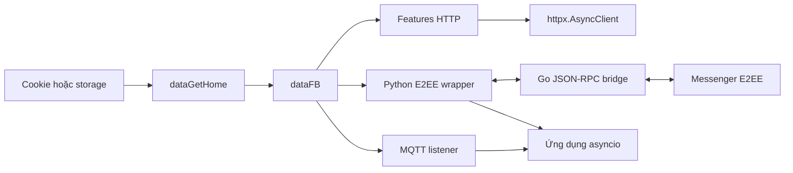

<div align="center">

# FBChat-Remake - Mã nguồn mở

### Thư viện Python async-first cho Facebook Messenger API không chính thức

[](https://github.com/m008v/fbchat-v2)
[](https://pypi.org/project/fbchat-v2/)
[](https://www.python.org/)
[](https://github.com/m008v/fbchat-v2/releases)
[](https://github.com/m008v/fbchat-v2/issues)
[](LICENSE)
[](https://t.me/MinhHuyDev)

[🇬🇧 English](README_EN.md) · [📖 Tài liệu](DOCS.md) · [📦 PyPI](https://pypi.org/project/fbchat-v2/) · [ 📊 Sơ đồ luồng](FLOWCHART.md) · [🐛 Báo lỗi](https://github.com/m008v/fbchat-v2/issues)

</div>

---

> [!IMPORTANT]
> Bản 2.3.4 dùng `async/await`. Nếu đang dùng bản cũ, bạn cần sửa cách gọi hàm theo ví dụ bên dưới. Muốn giữ code đồng bộ thì dùng bản [v2.1.4](https://github.com/m008v/fbchat-v2/tree/v2.1.4).

> [!WARNING]
> Đây không phải sản phẩm chính thức của Facebook. Nếu cần API chatbot chính thức, xem [Messenger Platform](https://developers.facebook.com/docs/messenger-platform/). `fbchat-v2` dùng tài khoản và cookie Facebook cá nhân, nên có rủi ro với bảo mật phiên và tài khoản. Cân nhắc trước khi sử dụng.

---

## 👋 Giới thiệu
Mình là MinhHuyDev (`m008v`), tác giả và người duy trì dự án.

`fbchat-v2` là thư viện Python để gửi và nhận tin nhắn Messenger bằng tài khoản Facebook cá nhân. Thư viện dùng `async/await`; E2EE chạy qua bridge Go. Codebase đã được tổ chức lại từ v2.2.0 và tiếp tục được sửa theo các lỗi người dùng báo về.

Từ 2.3.4, MQTT/E2EE tự nối lại khi mất mạng, phân biệt lỗi cookie và có callback
trạng thái. Xem [cách cấu hình](DOCS.md#tự-nối-lại).
E2EE cần bridge 2.3.4; wrapper không dùng binary cũ thiếu contract reconnect.

Cảm ơn mọi người đã góp ý và báo lỗi. Đây là API không chính thức nên một số chức năng có thể hỏng khi Facebook thay đổi. Nếu gặp lỗi, mở issue trên [GitHub](https://github.com/m008v/fbchat-v2/issues) kèm cách tái hiện và log đã che thông tin nhạy cảm, hoặc nhắn mình qua [Telegram](https://t.me/MinhHuyDev).

---

## 📚 Mục lục

- [Tính năng](#tính-năng)
- [Kiến trúc tổng quan](#kiến-trúc-tổng-quan)
- [Cấu trúc dự án](#cấu-trúc-dự-án)
- [Yêu cầu hệ thống](#yêu-cầu-hệ-thống)
- [Cài đặt](#cài-đặt)
- [Cấu hình](#cấu-hình)
- [Bắt đầu nhanh](#bắt-đầu-nhanh)
- [Sử dụng API async](#sử-dụng-api-async)
- [Listener E2EE](#listener-e2ee)
- [Bot mẫu](#bot-mẫu)
- [Tài liệu từng module](#tài-liệu-từng-module)
- [Kiểm tra chất lượng](#kiểm-tra-chất-lượng)
- [Bảo mật và giới hạn](#bảo-mật-và-giới-hạn)
- [Đóng góp](#đóng-góp)
- [Vinh danh](#vinh-danh)
- [Bản quyền](#bản-quyền)

---

## ✨ Tính năng

Thư viện dùng cookie hoặc thông tin đăng nhập của tài khoản cá nhân, không dùng `access_token` của fanpage như API chatbot chính thức. Các nhóm chức năng hiện có:

### Xác thực
- Đăng nhập bằng username/password hoặc cookie phiên (*).
- Tái sử dụng phiên đăng nhập để không phải đăng nhập lại mỗi lần chạy.

### Nhắn tin
- Đọc tin nhắn từ người dùng và nhóm chat (thread).
- Nhận tin cá nhân E2EE Messenger (Secret Conversations / Labyrinth) qua bridge Go.
- Gửi văn bản, tệp đính kèm, nhãn dán (sticker) và mention người dùng.
- Tìm kiếm tin nhắn và hội thoại.
- Sửa tin đã gửi, thả cảm xúc, thu hồi tin và xử lý message requests.
- Đổi theme/nền thread Messenger và quản lý Messenger Notes 24h.
- Nhận event theo thời gian thực để xử lý lệnh trong bot.

### Thread & Nhóm
- Tạo nhóm, thêm admin, đổi tên/emoji/biệt danh trong nhóm.
- Tạo cuộc thăm dò ý kiến (poll) và lấy metadata của thread.

### Tính năng Facebook (`_features._facebook`)
- Thả và gỡ cảm xúc bài viết timeline ([`_reactionPost`](src/fbchat_v2/_features/_facebook/README.md#-tiêu-điểm-_reactionpostpy-tương-tác-cảm-xúc): Like, Love, Care, Haha, Wow, Sad, Angry, Undo).
- Đăng bài (`_createPost`), lưu trữ (`_archivePost`) và xóa bài viết (`_deletePost`).
- Tìm kiếm người dùng (`_search`), lấy thông tin profile (`_get_user_info`) và quản lý thông báo (`_notification`).
- Chặn/bỏ chặn (`_blocking`), hủy kết bạn (`_unFriend`), quản lý Marketplace và chế độ Professional.
- Hướng dẫn chi tiết nằm trong [Tài liệu `fbchat_v2._features._facebook`](src/fbchat_v2/_features/_facebook/README.md).

### Mới cập nhật
- Các API chính dùng `async/await`; một số phần compatibility vẫn chạy blocking.
- Bridge E2EE có quy trình build và phân phối binary cho Windows, Linux và macOS.

> [!CAUTION]
> (*) Cookie và thông tin đăng nhập cho phép truy cập tài khoản. Không đưa chúng vào source, issue hoặc log công khai.

---

## 📂 Kiến trúc tổng quan

Codebase chia thành ba tầng. Core quản lý session và HTTP transport; feature và messaging dùng lại các phần này, không tự lưu credential trong code.

| Tầng | Đường dẫn | Trách nhiệm |
|---|---|---|
| Core | `src/fbchat_v2/_core/` | HTTP transport, session, storage, login và utility |
| Features | `src/fbchat_v2/_features/` | Nghiệp vụ Facebook và quản trị thread |
| Messaging | `src/fbchat_v2/_messaging/` | Send, listen, E2EE, attachment, reaction, theme và notes |



Xem luồng đầy đủ trong [FLOWCHART.md](FLOWCHART.md).


---

## 🗂️ Cấu trúc dự án

```text
fbchat-v2/
├── src/
│   ├── main.py                       # Bot mẫu async dùng listener E2EE
│   ├── config.example.json           # Template cấu hình được phép commit
│   ├── config.json                   # Cấu hình local, bị gitignore
│   ├── _core/
│   │   ├── _http.py                  # Transport httpx sync/async dùng chung
│   │   ├── _session.py               # Cookie -> dataFB
│   │   ├── _storage.py               # File/Env session storage
│   │   ├── _facebookLogin.py         # Credential login và 2FA
│   │   ├── _utils.py                 # Form, parser, cookie và ID helper
│   │   └── README.md
│   ├── _features/
│   │   ├── _facebook/                # Account, profile, Marketplace
│   │   ├── _thread/                  # Thread và group administration
│   │   └── README.md
│   └── _messaging/
│       ├── _send.py                  # Gửi tin thường qua HTTP
│       ├── _attachments.py           # Upload file
│       ├── _listening.py             # MQTT listener thường
│       ├── _listening_e2ee.py        # E2EE listener và bridge process
│       ├── _bridge_actions.py        # Action async qua bridge
│       ├── _send_e2ee.py             # Compatibility sender standalone
│       ├── _changeTheme.py
│       ├── _createNotes.py
│       ├── _editMessage.py
│       ├── _message_requests.py
│       ├── _reactions.py
│       ├── _unsend.py
│       └── README.md
├── bridge-e2ee/
│   ├── main.go                       # JSON-RPC dispatcher
│   ├── bridge/                       # Messenger/E2EE operations
│   ├── meta/                         # Git submodule mautrix-meta
│   ├── go.mod
│   └── README.md
├── build/                            # Binary bridge local
├── tests/                            # Unit và async contract tests
├── DOCS.md                           # Hướng dẫn API đầy đủ
├── FLOWCHART.md                      # Runtime flow
├── mindmap-mermaid.md                # Bản đồ codebase
├── CHANGELOG.md
└── pyproject.toml
```

---

## 🔧 Yêu cầu hệ thống

| Thành phần | Tối thiểu | Khuyến nghị | Ghi chú |
|---|---|---|---|
| Python | 3.10 | 3.11 / 3.12 | Bắt buộc |
| Go (toolchain) | 1.26.10 | 1.26.10+ | **Chỉ cần cho E2EE** - để build `fbchat-bridge-e2ee` |
| Git | bất kỳ | latest | Cần cho `go mod tidy` kéo `mautrix/meta` |
| Hệ điều hành | Windows / Linux / macOS | - | - |
| RAM | 256 MB | 1 GB+ | Bridge E2EE chiếm ~80–150 MB khi chạy |
| Mạng | Kết nối ổn định, không bị chặn `facebook.com` và `edge-chat.facebook.com` | - | - |

Phụ thuộc Python chính trong `pyproject.toml`:

```toml
dependencies = [
    "httpx>=0.27.0",
    "paho-mqtt>=1.6.1",
    "pyotp>=2.9.0",
    "requests>=2.32.0",
]
```

`httpx` xử lý HTTP cho session và các feature async. `requests` vẫn được dùng ở phần đăng nhập bằng thông tin tài khoản và upload compatibility chạy blocking.

---

## 📦 Cài đặt

> Các bước dưới đây hướng dẫn cài từ source. Môi trường ảo ở bước 2 là tùy chọn; bước 5 bắt buộc nếu chạy bot mẫu `src/main.py` hoặc dùng E2EE.

### 1. Clone mã nguồn

```bash
git clone --recurse-submodules https://github.com/m008v/fbchat-v2.git
cd fbchat-v2
```

> Cách khác: `Code → Download ZIP` trên GitHub.

### 2. Tạo môi trường ảo *(không bắt buộc nhưng khuyến nghị)*

```bash
python -m venv .venv
```

Kích hoạt môi trường:

```bash
# Windows (PowerShell)
.venv\Scripts\activate

# macOS / Linux
source .venv/bin/activate
```

### 3. Cài đặt phụ thuộc Python

```bash
python -m pip install --upgrade pip
python -m pip install -e .
```

Kiểm tra nhanh:

```bash
python -c "import fbchat_v2; from fbchat_v2._features._facebook import _unFriend; print('OK')"
```

### 4. Xác minh package đã cài

Chạy lệnh sau để kiểm tra namespace công khai `fbchat_v2`, với cả editable install và wheel:

```bash
python scripts/verify_distribution.py
```

Không cần đặt `PYTHONPATH=src` và không import bằng prefix `src.`.

### 5. Build bridge E2EE - bắt buộc cho bot mẫu

Nếu chỉ dùng API HTTP hoặc listener MQTT thường, bạn có thể bỏ qua bước này. `src/main.py`, `_e2ee_listening_test.py` và `_e2ee_send_test.py` cần binary Go `fbchat-bridge-e2ee`: nếu bridge không sẵn sàng, chúng dừng thay vì chuyển sang Python MQTT.

#### 5.1. Cài Go toolchain

- Tải về: <https://go.dev/dl/> (Go ≥ 1.26.10).
- Sau khi cài, mở terminal mới và kiểm tra:

  ```bash
  go version
  ```

#### 5.2. Kéo source `mautrix/meta`

Repo khai báo `bridge-e2ee/meta` trong `.gitmodules`. Với bản clone từ Git, dùng submodule:

```bash
git submodule update --init --recursive bridge-e2ee/meta
```

Nếu build từ bản source không có `.gitmodules`, clone thủ công:

```bash
cd bridge-e2ee
git clone https://github.com/mautrix/meta.git ./meta
```

> `go.mod` của `bridge-e2ee/` dùng directive `replace` trỏ tới thư mục `./meta`, nên path `bridge-e2ee/meta` phải tồn tại trước khi `go mod tidy` / `go build`.

#### 5.3. Tải dep & build

```bash
cd bridge-e2ee
go mod download

# Windows
go build -ldflags="-s -w" -o ../build/fbchat-bridge-e2ee.exe .

# Linux / macOS
go build -ldflags="-s -w" -o ../build/fbchat-bridge-e2ee .
```

Lần build đầu mất vài phút (~300 MB cache Go module). Sau đó binary khoảng 25–40 MB nằm ở `fbchat-v2/build/`.

#### 5.4. Verify

```bash
cd ..
# Windows
python scripts/smoke_bridge_rpc.py .\build\fbchat-bridge-e2ee.exe --expected-version 2.3.4
# Linux/macOS
python scripts/smoke_bridge_rpc.py ./build/fbchat-bridge-e2ee --expected-version 2.3.4
```

Nếu binary không nằm ở vị trí mặc định, đặt biến môi trường:

```bash
# Windows
$env:FBCHAT_E2EE_BIN = "C:\path\to\fbchat-bridge-e2ee.exe"
# Linux/macOS
export FBCHAT_E2EE_BIN=/path/to/fbchat-bridge-e2ee
```

Xem thêm trong [`bridge-e2ee/README.md`](bridge-e2ee/README.md).

### 6. Cấu hình cookie

Sao chép [`src/config.example.json`](src/config.example.json) thành `src/config.json`, rồi dán cookie phiên Facebook vào trường `cookies`. Xem chi tiết ở mục [Cấu hình](#-cấu-hình).

### 7. Smoke test

```bash
python src/main.py
```

Khi console in `E2EE listener đã sẵn sàng`, bot đã kết nối được listener. Thông báo này chưa chứng minh gửi/nhận tin hoạt động. Bot mẫu không in ID tài khoản, cookie hoặc `last_seq_id` để tránh lộ metadata.

---

## ⚙️ Cấu hình

Tạo file cấu hình local từ template:

```powershell
Copy-Item src\config.example.json src\config.json
```

```bash
cp src/config.example.json src/config.json
```

Ví dụ:

```json
{
  "botName": "fbchat-v2 demo bot",
  "prefix": "/",
  "cookies": "c_user=...; xs=...; fr=...; datr=...;",
  "admins": [
    "1000xxxxxxxxxx"
  ],
  "log_message_content": false,
  "debug_errors": false,
  "version": "0.0.1"
}
```

| Khóa | Bắt buộc | Ý nghĩa |
|---|---|---|
| `cookies` | Có | Cookie phiên Facebook dạng chuỗi |
| `prefix` | Không | Tiền tố lệnh, mặc định `/` |
| `admins` | Không | Danh sách Facebook ID được dùng lệnh quản trị |
| `log_message_content` | Không | Cho phép ghi plaintext nội dung chat; mặc định `false` để bảo vệ riêng tư |
| `debug_errors` | Không | In diagnostic đã redact để debug bridge; mặc định `false` |
| `botName` | Không | Metadata cho config, bot mẫu hiện không dùng |
| `version` | Không | Metadata cho config, bot mẫu hiện không dùng |

`src/config.json` được Git bỏ qua. Bot đặt quyền file thành `0600` trên
POSIX hoặc ACL riêng cho user hiện tại/SYSTEM trên Windows. Không dùng
`config.example.json` để chứa cookie thật, và chỉ bật hai tùy chọn log trên khi
đang debug trong môi trường kiểm soát.

---

## 🚀 Bắt đầu nhanh

Sau khi cấu hình cookie và bridge:

```bash
python src/main.py
```

Bot đợi cả kết nối thường và E2EE sẵn sàng trước khi xử lý lệnh. Các lệnh mẫu:

```text
/ping
/help
/id
/echo xin chào
/search Minh
/unsend
```

`/unsend` chỉ thu hồi tin E2EE cuối do bot gửi trong chat hiện tại. Chat thường không có `chatJid` sẽ được từ chối rõ ràng.

---

## ⚡ Sử dụng API async

### Tạo session từ cookie

```python
import asyncio

from fbchat_v2._core._session import dataGetHome


async def main() -> None:
    data_fb = await dataGetHome("c_user=...; xs=...; fr=...; datr=...;")
    if data_fb is None:
        raise RuntimeError("Cookie hết hạn hoặc Facebook đã đổi token HTML.")
    print(data_fb["FacebookID"])


asyncio.run(main())
```

Trong FastAPI, Jupyter hoặc bot framework đã có event loop, gọi `await dataGetHome(...)` trực tiếp. Không lồng thêm `asyncio.run()`.

### Gửi tin nhắn thường

```python
from fbchat_v2._messaging._send import api as SendAPI

sender = SendAPI()
result = await sender.send(
    data_fb,
    "Xin chào từ fbchat-v2",
    threadID="100012345678"
)
if result.get("error"):
    raise RuntimeError(result["payload"]["error-description"])
```

`threadID` có thể là một ID hoặc danh sách ID khi `typeChat="user"`. Khi gửi attachment, `typeAttachment` và `attachmentID` phải đi cùng nhau.

### Tái sử dụng HTTP connection

```python
import asyncio
import httpx

from fbchat_v2._features._facebook import _notification, _search

async with httpx.AsyncClient(timeout=30) as client:
    notifications, users = await asyncio.gather(
        _notification.func(data_fb, client=client),
        _search.func(data_fb, "Minh", client=client),
    )
```

Bạn tạo client thì cũng cần đóng nó sau khi dùng. Không dùng lại client đã đóng hoặc truyền `httpx.Client` sync vào tham số `client=` của API async.

### Upload attachment

```python
from fbchat_v2._messaging import _attachments
from fbchat_v2._messaging._send import api as SendAPI

uploaded = await _attachments.func("photo.jpg", data_fb, include_error=True)
if not uploaded or not uploaded.get("attachmentID"):
    raise RuntimeError(f"Upload thất bại: {uploaded}")

await SendAPI().send(
    data_fb,
    "Ảnh đính kèm (file path)",
    threadID="100012345678",
    typeAttachment=uploaded["typeAttachment"],
    attachmentID=uploaded["attachmentID"],
)
```

### Listener MQTT thường

```python
import asyncio

from fbchat_v2._messaging._listening import listeningEvent

listener = listeningEvent(data_fb, message_queue_maxsize=1000)
listener_task = asyncio.create_task(listener.connect_mqtt())
try:
    while True:
        event = await listener.get_message(timeout=30)
        if event is not None:
            print(event)
finally:
    await listener.disconnect()
    await listener_task
```

Đọc từng event qua `get_message()`. `bodyResults` chỉ giữ snapshot để tương thích với code cũ, nên có thể bỏ lỡ event khi nhiều tin đến cùng lúc.

---

## 🔐 Listener E2EE

`listeningE2EEEvent` khởi chạy bridge Go và trao đổi JSON-RPC qua stdin/stdout. Callback của bridge chạy ngoài event loop. Với ứng dụng asyncio, chuyển event vào `asyncio.Queue` bằng `loop.call_soon_threadsafe` như ví dụ dưới đây.

```python
import asyncio

from fbchat_v2._messaging._listening_e2ee import listeningE2EEEvent


async def run_listener(data_fb: dict) -> None:
    listener = listeningE2EEEvent(data_fb)
    loop = asyncio.get_running_loop()
    events: asyncio.Queue[dict] = asyncio.Queue(maxsize=1000)

    def enqueue(event: dict) -> None:
        if events.full():
            events.get_nowait()
        events.put_nowait(event)

    listener.on_message(
        lambda event: loop.call_soon_threadsafe(enqueue, event)
    )
    listener_task = asyncio.create_task(listener.connect_mqtt())

    try:
        ready = await asyncio.to_thread(
            listener.wait_until_connected,
            listener.startup_timeout,
            require_e2ee=True,
        )
        if not ready:
            raise TimeoutError("E2EE handshake chưa hoàn tất.")

        await listener.send_e2ee_message(
            "100012345678@msgr",
            "Xin chào E2EE",
        )

        while True:
            event = await events.get()
            if event.get("type") in {"e2eeMessage", "message"}:
                print(event["data"])
    finally:
        listener.stop()
        await listener_task
```

Event chính:

| Type | Dữ liệu đáng chú ý | Ý nghĩa |
|---|---|---|
| `ready` | `isNewSession` | Bridge đã tạo client |
| `e2eeConnected` | trạng thái handshake | Signal/Labyrinth đã sẵn sàng |
| `e2eeMessage` | `chatJid`, `senderJid`, `id`, `text` | Tin cá nhân đã giải mã |
| `message` | `threadId`, `senderId`, `id`, `text` | Tin thường |
| `error` | lỗi bridge/transport | Cần log và giám sát |
| `bridge_fatal` | số lần retry | Watchdog đã bỏ cuộc |

Các action edit, unsend, typing, mark-read, gửi ảnh/audio và download media nằm trong `BridgeActions`. Cách dùng có trong [tài liệu messaging](src/fbchat_v2/_messaging/README.md).

---

## 🤖 Bot mẫu

[`src/main.py`](src/main.py) ghép các phần trên thành một bot async:

1. Đọc config bằng `FileSessionStorage`.
2. Gọi `await dataGetHome(...)` và kiểm tra các field bắt buộc.
3. Mở một `httpx.AsyncClient` dùng chung cho command HTTP.
4. Chạy `listeningE2EEEvent.connect_mqtt()` trong một task.
5. Chuyển callback bridge sang `asyncio.Queue` thread-safe.
6. Đọc lệnh và bỏ qua message do chính bot gửi.
7. Trả lời bằng E2EE khi có `chatJid`, gửi tin thường khi chỉ có `threadId`.
8. Dừng bridge, await task và đóng HTTP client khi shutdown.

Queue của bot chứa tối đa 1000 event và bỏ event cũ nhất khi đầy. Cách này giới hạn bộ nhớ khi tin đến dồn dập, nhưng có thể làm mất event; không phải cơ chế đảm bảo giao nhận.

---

## 📖 Tài liệu từng module

| Tài liệu | Nội dung |
|---|---|
| [DOCS.md](DOCS.md) | Hướng dẫn API và workflow đầy đủ |
| [Core](src/fbchat_v2/_core/README.md) | Session, HTTP, storage và login |
| [Features](src/fbchat_v2/_features/README.md) | Facebook feature và thread |
| [Messaging](src/fbchat_v2/_messaging/README.md) | Send, listener, attachment và E2EE |
| [Bridge E2EE](bridge-e2ee/README.md) | Build, binary discovery và JSON-RPC |
| [Flowchart](FLOWCHART.md) | Luồng session, HTTP, MQTT, E2EE và shutdown |
| [Mindmap](mindmap-mermaid.md) | Bản đồ module toàn dự án |

---

## ✅ Kiểm tra chất lượng

Chạy test bằng lệnh CI đang dùng:

```bash
pytest tests/ -v --tb=short
```

Trước khi commit, chạy thêm các bước kiểm tra:

```bash
python -m compileall -q src tests scripts
ruff check src tests scripts
black --check src tests scripts
mypy
python -m build --wheel
python scripts/verify_distribution.py dist/fbchat_v2-2.3.4-py3-none-any.whl
git diff --check
```

CI cài wheel và editable install vào hai virtual environment sạch trước khi chạy smoke test import.

Với bridge:

```bash
cd bridge-e2ee
go test ./...
go vet ./...
```

Lưu tài liệu tiếng Việt bằng UTF-8. Nếu PowerShell hiển thị ký tự lạ, kiểm tra codepoint hoặc đọc file với `encoding="utf-8"` trước khi sửa; lỗi hiển thị ở terminal chưa chắc là lỗi trong file.

---

## 🌟 Vinh danh người đóng góp

Trong 4 năm phát triển, nhiều người đã góp ý tưởng, báo lỗi và giúp duy trì `fbchat`. Cảm ơn mọi người đã dành thời gian cho dự án.

### 👥 Cộng đồng đóng góp

- [tomdev112](https://github.com/tomdev211)
- [syrex1013](https://github.com/syrex1013)
- [Kheir Eddine](https://www.facebook.com/61557637127396/)
- 陶世玉
- Jihadi John
- [Bắc Trịnh](https://www.facebook.com/1228855777/)
- [Quang Trần](https://www.facebook.com/100005048402622/)
- [Minh Trần Ngọc](https://www.facebook.com/100000277273223/)
- Victor Knutsenberger
- [Hoàng Lân](https://www.facebook.com/100026754347158/)
- Kareem Adel Abomandor
- @lluevy · @phuncnheo · @minhphatnw · @khanh235a · @chapesh1 · @klongg13 · @seafibrahem · @agent1047 · @stefekdziura

> Nếu bạn đã đóng góp nhưng chưa có tên ở đây, mở issue hoặc PR để mình bổ sung nhé.

---

## 📜 Bản quyền

Dự án được phân phối theo điều khoản trong [LICENSE](LICENSE). Phần bridge có thành phần upstream với giấy phép riêng; xem [bridge-e2ee/README.md](bridge-e2ee/README.md) trước khi phân phối binary.

<div align="center">

[MinhHuyDev](https://github.com/m008v) | [Telegram](https://t.me/MinhHuyDev)

</div>
