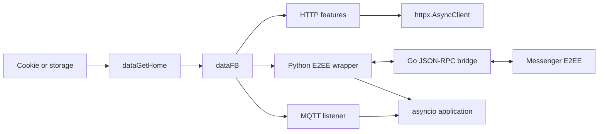

<div align="center">

# FBChat-Remake - Open Source

### Async-first Python library for the unofficial Facebook Messenger API

[](https://github.com/m008v/fbchat-v2)
[](https://pypi.org/project/fbchat-v2/)
[](https://www.python.org/)
[](https://github.com/m008v/fbchat-v2/releases)
[](https://github.com/m008v/fbchat-v2/issues)
[](LICENSE)
[](https://t.me/MinhHuyDev)

[🇻🇳 Tiếng Việt](README.md) · [📖 Documentation](DOCS.md) · [📦 PyPI](https://pypi.org/project/fbchat-v2/) · [ 📊 Flowchart](FLOWCHART.md) · [🐛 Report bugs](https://github.com/m008v/fbchat-v2/issues)

</div>

---


> [!IMPORTANT]
> Version 2.3.4 uses `async/await`. If you're upgrading from an older version, update your function calls using the examples below. To keep using the synchronous API, use [v2.1.4](https://github.com/m008v/fbchat-v2/tree/v2.1.4).

> [!WARNING]
> This is not an official Facebook product. For the official chatbot API, see [Messenger Platform](https://developers.facebook.com/docs/messenger-platform/). `fbchat-v2` uses personal Facebook accounts and session cookies, which carries risks for your session credentials and account. Consider those risks before using it.

---

## 👋 Introduction

I'm MinhHuyDev (`m008v`), the author and maintainer of this project.

`fbchat-v2` is a Python library for sending and receiving Messenger messages through a personal Facebook account. It uses `async/await`, with a Go bridge for E2EE. The codebase was reorganized in v2.2.0 and has continued to receive fixes based on user reports.

Version 2.3.4 adds MQTT/E2EE reconnect support: network retries, separate
authentication failures, and connection-state callbacks.
See the [configuration guide](DOCS.md#tự-nối-lại).
E2EE requires the 2.3.4 bridge; the wrapper rejects older binaries without the reconnect contract.

Thanks to everyone who has shared ideas and reported bugs. This is an unofficial API, so features can break when Facebook changes. If you run into a problem, open an issue on [GitHub](https://github.com/m008v/fbchat-v2/issues) with reproduction steps and redacted logs, or reach me on [Telegram](https://t.me/MinhHuyDev).

---

## 📚 Table of Contents

- [Features](#-features)
- [Architecture Overview](#-architecture-overview)
- [Project Structure](#️-project-structure)
- [System Requirements](#-system-requirements)
- [Installation](#-installation)
- [Configuration](#️-configuration)
- [Quick Start](#-quick-start)
- [Using the Async API](#-using-the-async-api)
- [E2EE Listener](#-e2ee-listener)
- [Sample Bot](#-sample-bot)
- [Module Documentation](#-module-documentation)
- [Quality Checks](#-quality-checks)
- [Security and Limits](#security-and-limits)
- [Contributing](#contributing)
- [Credits](#-credits)
- [License](#-license)

---

## ✨ Features

The library uses a personal account's cookies or login credentials rather than the Page `access_token` used by the official chatbot API. It includes the following features:

### Authentication

- Log in with a username/password or session cookie (*).
- Reuse a session instead of logging in every time the program starts.

### Messaging

- Read messages from users and group chats (threads).
- Receive E2EE personal messages (Secret Conversations / Labyrinth) through the Go bridge.
- Send text, attachments, stickers, and user mentions.
- Search messages and conversations.
- Edit sent messages, react, unsend, and handle message requests.
- Change thread themes/backgrounds and manage 24-hour Messenger Notes.
- Receive events in real time for bot command handling.

### Threads & Groups

- Create groups, add admins, and change group names/emojis/nicknames.
- Create polls and fetch thread metadata.

### Facebook Features (`_features._facebook`)

- React and unreact to timeline posts ([`_reactionPost`](src/fbchat_v2/_features/_facebook/README_EN.md#-spotlight-_reactionpostpy-post-reactions): Like, Love, Care, Haha, Wow, Sad, Angry, Undo).
- Create posts (`_createPost`), archive posts (`_archivePost`), and delete posts (`_deletePost`).
- Search users (`_search`), fetch profile info (`_get_user_info`), and manage notifications (`_notification`).
- Block/unblock (`_blocking`), unfriend users (`_unFriend`), and manage Marketplace and Professional Mode.
- See the [Facebook Features Documentation](src/fbchat_v2/_features/_facebook/README_EN.md) for usage details.

### Recently Updated

- The main APIs use `async/await`; some compatibility paths are still blocking.
- The E2EE bridge has a binary build and distribution workflow for Windows, Linux, and macOS.

> [!CAUTION]
> (*) Cookies and login credentials grant access to your account. Keep them out of source code, issues, and public logs.

---

## 📂 Architecture Overview

The codebase has three layers. Core manages sessions and HTTP transport; feature and messaging modules reuse them rather than storing credentials in code.

| Layer | Path | Responsibility |
|---|---|---|
| Core | `src/fbchat_v2/_core/` | HTTP transport, session, storage, login, and utilities |
| Features | `src/fbchat_v2/_features/` | Facebook business features and thread administration |
| Messaging | `src/fbchat_v2/_messaging/` | Send, listen, E2EE, attachment, reaction, theme, and notes |



See [FLOWCHART.md](FLOWCHART.md) for the full flow.

---

## 🗂️ Project Structure

```text
fbchat-v2/
├── src/
│   ├── main.py                       # Sample async bot using the E2EE listener
│   ├── config.example.json           # Configuration template safe to commit
│   ├── config.json                   # Local configuration, gitignored
│   ├── _core/
│   │   ├── _http.py                  # Shared sync/async httpx transport
│   │   ├── _session.py               # Cookie -> dataFB
│   │   ├── _storage.py               # File/env session storage
│   │   ├── _facebookLogin.py         # Credential login and 2FA
│   │   ├── _utils.py                 # Form, parser, cookie, and ID helpers
│   │   └── README.md
│   ├── _features/
│   │   ├── _facebook/                # Account, profile, Marketplace
│   │   ├── _thread/                  # Thread and group administration
│   │   └── README.md
│   └── _messaging/
│       ├── _send.py                  # Send regular messages through HTTP
│       ├── _attachments.py           # Upload files
│       ├── _listening.py             # Regular MQTT listener
│       ├── _listening_e2ee.py        # E2EE listener and bridge process
│       ├── _bridge_actions.py        # Async actions through the bridge
│       ├── _send_e2ee.py             # Standalone compatibility sender
│       ├── _changeTheme.py
│       ├── _createNotes.py
│       ├── _editMessage.py
│       ├── _message_requests.py
│       ├── _reactions.py
│       ├── _unsend.py
│       └── README.md
├── bridge-e2ee/
│   ├── main.go                       # JSON-RPC dispatcher
│   ├── bridge/                       # Messenger/E2EE operations
│   ├── meta/                         # mautrix-meta Git submodule
│   ├── go.mod
│   └── README.md
├── build/                            # Local bridge binary
├── tests/                            # Unit and async contract tests
├── DOCS.md                           # Full API guide
├── FLOWCHART.md                      # Runtime flow
├── mindmap-mermaid.md                # Codebase map
├── CHANGELOG.md
└── pyproject.toml
```

---

## 🔧 System Requirements

| Component | Minimum | Recommended | Notes |
|---|---|---|---|
| Python | 3.10 | 3.11 / 3.12 | Required |
| Go (toolchain) | 1.26.10 | 1.26.10+ | **Only required for E2EE** - used to build `fbchat-bridge-e2ee` |
| Git | any | latest | Needed for `go mod tidy` to pull `mautrix/meta` |
| OS | Windows / Linux / macOS | - | - |
| RAM | 256 MB | 1 GB+ | The E2EE bridge uses about 80-150 MB while running |
| Network | Stable connection, not blocked from `facebook.com` and `edge-chat.facebook.com` | - | - |

Main Python dependencies in `pyproject.toml`:

```toml
dependencies = [
    "httpx>=0.27.0",
    "paho-mqtt>=1.6.1",
    "pyotp>=2.9.0",
    "requests>=2.32.0",
]
```

`httpx` handles HTTP for sessions and async features. Credential login and compatibility upload still use `requests` in blocking code.

---

## 📦 Installation

> These steps install the project from source. The virtual environment in step 2 is optional; step 5 is required for the `src/main.py` sample bot or any E2EE usage.

### 1. Clone the source

```bash
git clone --recurse-submodules https://github.com/m008v/fbchat-v2.git
cd fbchat-v2
```

> Alternative: use `Code -> Download ZIP` on GitHub.

### 2. Create a virtual environment *(optional but recommended)*

```bash
python -m venv .venv
```

Activate the environment:

```bash
# Windows (PowerShell)
.venv\Scripts\activate

# macOS / Linux
source .venv/bin/activate
```

### 3. Install Python dependencies

```bash
python -m pip install --upgrade pip
python -m pip install -e .
```

Quick check:

```bash
python -c "import fbchat_v2; from fbchat_v2._features._facebook import _unFriend; print('OK')"
```

### 4. Verify the installed packages

Check that the installed package exposes the public `fbchat_v2` namespace. This applies to both editable installs and wheels:

```bash
python scripts/verify_distribution.py
```

You do not need `PYTHONPATH=src`, and imports must not use a `src.` prefix.

### 5. Build the E2EE bridge - required for the sample bot

You can skip this step if you only use HTTP APIs or the regular MQTT listener. The `src/main.py`, `_e2ee_listening_test.py`, and `_e2ee_send_test.py` entrypoints need the Go `fbchat-bridge-e2ee` binary: if the bridge is not ready, they stop instead of falling back to Python MQTT.

#### 5.1. Install the Go toolchain

- Download it from: <https://go.dev/dl/> (Go >= 1.26.10).
- After installation, open a new terminal and check:

  ```bash
  go version
  ```

#### 5.2. Pull the `mautrix/meta` source

The repo declares `bridge-e2ee/meta` in `.gitmodules`. For a Git checkout, use the submodule:

```bash
git submodule update --init --recursive bridge-e2ee/meta
```

If you are building from a source copy without `.gitmodules`, clone it manually:

```bash
cd bridge-e2ee
git clone https://github.com/mautrix/meta.git ./meta
```

> `bridge-e2ee/go.mod` uses a `replace` directive pointing to `./meta`, so the path `bridge-e2ee/meta` must exist before `go mod tidy` / `go build`.

#### 5.3. Download dependencies & build

```bash
cd bridge-e2ee
go mod download

# Windows
go build -ldflags="-s -w" -o ../build/fbchat-bridge-e2ee.exe .

# Linux / macOS
go build -ldflags="-s -w" -o ../build/fbchat-bridge-e2ee .
```

The first build may take a few minutes and about 300 MB of Go module cache. After that, the binary is about 25-40 MB and is placed in `fbchat-v2/build/`.

#### 5.4. Verify

```bash
cd ..
# Windows
python scripts/smoke_bridge_rpc.py .\build\fbchat-bridge-e2ee.exe --expected-version 2.3.4
# Linux/macOS
python scripts/smoke_bridge_rpc.py ./build/fbchat-bridge-e2ee --expected-version 2.3.4
```

If the binary is not in the default location, set the environment variable:

```bash
# Windows
$env:FBCHAT_E2EE_BIN = "C:\path\to\fbchat-bridge-e2ee.exe"
# Linux/macOS
export FBCHAT_E2EE_BIN=/path/to/fbchat-bridge-e2ee
```

More details: [`bridge-e2ee/README.md`](bridge-e2ee/README.md).

### 6. Configure cookies

Copy [`src/config.example.json`](src/config.example.json) to `src/config.json`, then paste your Facebook session cookie into the `cookies` field. See the [Configuration](#️-configuration) section for details.

### 7. Smoke test

```bash
python src/main.py
```

When the console prints `E2EE listener đã sẵn sàng`, the bot has connected its listener. This does not yet prove that sending and receiving messages works. The sample bot does not print account IDs, cookies, or `last_seq_id` metadata.

---

## ⚙️ Configuration

Create a local configuration file from the template:

```powershell
Copy-Item src\config.example.json src\config.json
```

```bash
cp src/config.example.json src/config.json
```

Example:

```json
{
  "botName": "fbchat-v2 demo bot",
  "prefix": "/",
  "cookies": "c_user=...; xs=...; fr=...; datr=...;",
  "admins": [
    "1000xxxxxxxxxx"
  ],
  "log_message_content": false,
  "debug_errors": false,
  "version": "0.0.1"
}
```

| Key | Required | Meaning |
|---|---|---|
| `cookies` | Yes | Facebook session cookie as a string |
| `prefix` | No | Command prefix, defaults to `/` |
| `admins` | No | List of Facebook IDs allowed to use admin commands |
| `log_message_content` | No | Allow plaintext message logging; defaults to `false` for privacy |
| `debug_errors` | No | Print redacted bridge diagnostics; defaults to `false` |
| `botName` | No | Config metadata, currently unused by the sample bot |
| `version` | No | Config metadata, currently unused by the sample bot |

`src/config.json` is gitignored, and the sample bot restricts it to mode `0600`
on POSIX or a current-user/SYSTEM ACL on Windows. Do not store real cookies in
`config.example.json`, and only enable the two logging options while debugging
in a controlled environment.

---

## 🚀 Quick Start

After configuring cookies and the bridge:

```bash
python src/main.py
```

The bot waits until both the regular connection and E2EE connection are ready before processing commands. Sample commands:

```text
/ping
/help
/id
/echo hello
/search Minh
/unsend
```

`/unsend` only recalls the latest E2EE message sent by the bot in the current chat. Regular chats without `chatJid` are rejected with a clear message.

---

## ⚡ Using the Async API

### Create a session from cookies

```python
import asyncio

from fbchat_v2._core._session import dataGetHome


async def main() -> None:
    data_fb = await dataGetHome("c_user=...; xs=...; fr=...; datr=...;")
    if data_fb is None:
        raise RuntimeError("Cookie expired or Facebook changed the HTML token flow.")
    print(data_fb["FacebookID"])


asyncio.run(main())
```

In FastAPI, Jupyter, or any bot framework that already has an event loop, call `await dataGetHome(...)` directly. Do not nest another `asyncio.run()`.

### Send a regular message

```python
from fbchat_v2._messaging._send import api as SendAPI

sender = SendAPI()
result = await sender.send(
    data_fb,
    "Hello from fbchat-v2",
    threadID="100012345678"
)
if result.get("error"):
    raise RuntimeError(result["payload"]["error-description"])
```

`threadID` can be a single ID or a list of IDs when `typeChat="user"`. When sending an attachment, `typeAttachment` and `attachmentID` must be passed together.

### Reuse HTTP connections

```python
import asyncio
import httpx

from fbchat_v2._features._facebook import _notification, _search

async with httpx.AsyncClient(timeout=30) as client:
    notifications, users = await asyncio.gather(
        _notification.func(data_fb, client=client),
        _search.func(data_fb, "Minh", client=client),
    )
```

If you create the client, close it when you are done. Do not reuse a closed client or pass a sync `httpx.Client` to the `client=` parameter of an async API.

### Upload an attachment

```python
from fbchat_v2._messaging import _attachments
from fbchat_v2._messaging._send import api as SendAPI

uploaded = await _attachments.func("photo.jpg", data_fb, include_error=True)
if not uploaded or not uploaded.get("attachmentID"):
    raise RuntimeError(f"Upload failed: {uploaded}")

await SendAPI().send(
    data_fb,
    "Attached image (file path)",
    threadID="100012345678",
    typeAttachment=uploaded["typeAttachment"],
    attachmentID=uploaded["attachmentID"],
)
```

### Regular MQTT listener

```python
import asyncio

from fbchat_v2._messaging._listening import listeningEvent

listener = listeningEvent(data_fb, message_queue_maxsize=1000)
listener_task = asyncio.create_task(listener.connect_mqtt())
try:
    while True:
        event = await listener.get_message(timeout=30)
        if event is not None:
            print(event)
finally:
    await listener.disconnect()
    await listener_task
```

Read each event through `get_message()`. `bodyResults` keeps a snapshot for compatibility with older code, so it can miss events when messages arrive in bursts.

---

## 🔐 E2EE Listener

`listeningE2EEEvent` starts the Go bridge and exchanges JSON-RPC through stdin/stdout. Bridge callbacks run outside the event loop. In an asyncio application, use `loop.call_soon_threadsafe` to put events into an `asyncio.Queue`, as shown below.

```python
import asyncio

from fbchat_v2._messaging._listening_e2ee import listeningE2EEEvent


async def run_listener(data_fb: dict) -> None:
    listener = listeningE2EEEvent(data_fb)
    loop = asyncio.get_running_loop()
    events: asyncio.Queue[dict] = asyncio.Queue(maxsize=1000)

    def enqueue(event: dict) -> None:
        if events.full():
            events.get_nowait()
        events.put_nowait(event)

    listener.on_message(
        lambda event: loop.call_soon_threadsafe(enqueue, event)
    )
    listener_task = asyncio.create_task(listener.connect_mqtt())

    try:
        ready = await asyncio.to_thread(
            listener.wait_until_connected,
            listener.startup_timeout,
            require_e2ee=True,
        )
        if not ready:
            raise TimeoutError("E2EE handshake did not complete.")

        await listener.send_e2ee_message(
            "100012345678@msgr",
            "Hello E2EE",
        )

        while True:
            event = await events.get()
            if event.get("type") in {"e2eeMessage", "message"}:
                print(event["data"])
    finally:
        listener.stop()
        await listener_task
```

Main events:

| Type | Notable data | Meaning |
|---|---|---|
| `ready` | `isNewSession` | Bridge client has been created |
| `e2eeConnected` | handshake status | Signal/Labyrinth is ready |
| `e2eeMessage` | `chatJid`, `senderJid`, `id`, `text` | Decrypted personal message |
| `message` | `threadId`, `senderId`, `id`, `text` | Regular message |
| `error` | bridge/transport error | Should be logged and monitored |
| `bridge_fatal` | retry count | Watchdog gave up |

`BridgeActions` provides edit, unsend, typing, mark-read, image/audio sending, and media download actions. See the [messaging documentation](src/fbchat_v2/_messaging/README.md) for usage details.

---

## 🤖 Sample Bot

[`src/main.py`](src/main.py) brings these pieces together in an async bot:

1. Read config with `FileSessionStorage`.
2. Call `await dataGetHome(...)` and validate required fields.
3. Open one shared `httpx.AsyncClient` for HTTP commands.
4. Start `listeningE2EEEvent.connect_mqtt()` as a task.
5. Move bridge callbacks into a thread-safe `asyncio.Queue`.
6. Parse commands and ignore messages sent by the bot itself.
7. Reply through E2EE when `chatJid` exists, or send a regular message when only `threadId` exists.
8. Stop the bridge, await the task, and close the HTTP client during shutdown.

The bot queue holds up to 1000 events and drops the oldest event when full. This bounds memory use during bursts, but events can be lost; it is not a delivery guarantee.

---

## 📖 Module Documentation

| Documentation | Content |
|---|---|
| [DOCS.md](DOCS.md) | Full API and workflow guide |
| [Core](src/fbchat_v2/_core/README.md) | Session, HTTP, storage, and login |
| [Features](src/fbchat_v2/_features/README.md) | Facebook features and threads |
| [Messaging](src/fbchat_v2/_messaging/README.md) | Send, listener, attachment, and E2EE |
| [Bridge E2EE](bridge-e2ee/README.md) | Build, binary discovery, and JSON-RPC |
| [Flowchart](FLOWCHART.md) | Session, HTTP, MQTT, E2EE, and shutdown flow |
| [Mindmap](mindmap-mermaid.md) | Codebase-wide module map |

---

## ✅ Quality Checks

Run the test command used by CI:

```bash
pytest tests/ -v --tb=short
```

Before committing, run these checks as well:

```bash
python -m compileall -q src tests scripts
ruff check src tests scripts
black --check src tests scripts
mypy
python -m build --wheel
python scripts/verify_distribution.py dist/fbchat_v2-2.3.4-py3-none-any.whl
git diff --check
```

CI installs the wheel and editable project into separate clean virtual environments before running the import smoke test.

For the bridge:

```bash
cd bridge-e2ee
go test ./...
go vet ./...
```

Save Vietnamese documentation as UTF-8. If PowerShell displays strange characters, inspect the codepoints or read the file with `encoding="utf-8"` before editing it; a terminal display problem does not necessarily mean the file is corrupted.

---

## 🌟 Credits

Over 4 years of development, people have shared ideas, reported bugs, and helped maintain `fbchat`. Thanks to everyone who has put time into the project.

### 👥 Community Contributors

- [tomdev112](https://github.com/tomdev211)
- [syrex1013](https://github.com/syrex1013)
- [Kheir Eddine](https://www.facebook.com/61557637127396/)
- 陶世玉
- Jihadi John
- [Bắc Trịnh](https://www.facebook.com/1228855777/)
- [Quang Trần](https://www.facebook.com/100005048402622/)
- [Minh Trần Ngọc](https://www.facebook.com/100000277273223/)
- Victor Knutsenberger
- [Hoàng Lân](https://www.facebook.com/100026754347158/)
- Kareem Adel Abomandor
- @lluevy · @phuncnheo · @minhphatnw · @khanh235a · @chapesh1 · @klongg13 · @seafibrahem · @agent1047 · @stefekdziura

> If you have contributed but your name is missing, open an issue or PR so I can add it.

---

## 📜 License

This project is distributed under the terms in [LICENSE](LICENSE). The bridge includes upstream components with separate licenses; review [bridge-e2ee/README.md](bridge-e2ee/README.md) before distributing binaries.

<div align="center">

[MinhHuyDev](https://github.com/m008v) | [Telegram](https://t.me/MinhHuyDev)

</div>
