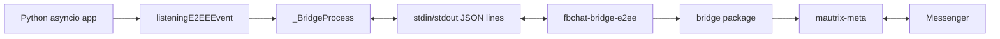

# fbchat-v2 - Bridge E2EE

Bridge Go cho tin nhắn Messenger thường và chat cá nhân E2EE. Python chạy binary như tiến trình con: gửi JSON-RPC từng dòng qua stdin, rồi đọc kết quả và event qua stdout.

[](../README.md)
[](../src/fbchat_v2/_messaging/README.md)
[](../FLOWCHART.md)

> [!IMPORTANT]
> Nếu viết ứng dụng Python, dùng `await listeningE2EEEvent.connect_mqtt()`, `await listener.send_e2ee_message()` và các hàm async của `BridgeActions`. Phần stdin/stdout bên dưới dành cho việc tích hợp hoặc debug bridge trực tiếp.

## 📋 Mục lục

- [Kiến trúc](#kiến-trúc)
- [Yêu cầu](#yêu-cầu)
- [Build từ source](#build-từ-source)
- [Binary discovery và auto-download](#binary-discovery-và-auto-download)
- [Cấu hình client](#cấu-hình-client)
- [Giao thức JSON-RPC](#giao-thức-json-rpc)
- [Method hỗ trợ](#method-hỗ-trợ)
- [Event](#event)
- [Python integration](#python-integration)
- [Watchdog và shutdown](#watchdog-và-shutdown)
- [Bảo mật](#bảo-mật)
- [Test](#test)
- [Khắc phục sự cố](#khắc-phục-sự-cố)
- [Giấy phép](#giấy-phép)

---

## 🏗️ Kiến trúc



Bridge chạy trong tiến trình riêng để:

- Tách trạng thái và giao thức E2EE khỏi tiến trình Python.
- Không để crash của bridge làm crash trực tiếp tiến trình Python.
- Dùng JSON từng dòng, thuận tiện cho việc giả lập khi test.
- Cho phép watchdog khởi động lại bridge và thiết lập lại kết nối.

`bridge-e2ee/meta` là Git submodule. `go.mod` dùng:

```go
replace go.mau.fi/mautrix-meta => ./meta
```

Build sẽ lỗi nếu thiếu thư mục `meta`.

---

## 📦 Yêu cầu

| Thành phần | Yêu cầu |
|---|---|
| Go | 1.26.10 theo directive trong `go.mod` |
| Git | Có hỗ trợ submodule |
| Hệ điều hành | Windows, Linux hoặc macOS |
| Cookie | `c_user`, `xs`, `datr`, `fr` |

Kiểm tra toolchain:

```bash
go version
git --version
```

Nếu Go đang cài thấp hơn phiên bản ghi trong `go.mod`, lệnh build có thể bị từ chối hoặc tự tải toolchain, tùy cấu hình `GOTOOLCHAIN`.

---

## 🔨 Build từ source

### Clone có submodule

```bash
git clone --recurse-submodules https://github.com/m008v/fbchat-v2.git
cd fbchat-v2
```

Repo đã clone nhưng thiếu submodule:

```bash
git submodule update --init --recursive bridge-e2ee/meta
```

### Windows PowerShell

```powershell
Set-Location bridge-e2ee
go mod download
go test ./...
New-Item -ItemType Directory -Force ..\build | Out-Null
go build -ldflags="-s -w" -o ..\build\fbchat-bridge-e2ee.exe .
Set-Location ..
```

### Linux hoặc macOS

```bash
cd bridge-e2ee
go mod download
go test ./...
mkdir -p ../build
go build -ldflags="-s -w" -o ../build/fbchat-bridge-e2ee .
cd ..
chmod +x build/fbchat-bridge-e2ee
```

Không cần chạy `go mod tidy` mỗi lần build. Dùng `go mod download` để tải dependency mà không cập nhật `go.mod`/`go.sum`. Chỉ chạy `tidy` khi thay đổi dependency và kiểm tra diff sau đó.

### Build từ source archive không có `.gitmodules`

Fallback:

```bash
cd bridge-e2ee
git clone https://github.com/mautrix/meta.git ./meta
go mod download
mkdir -p ../build
go build -o ../build/fbchat-bridge-e2ee .
```

Để có thể build lại cùng một bản, dùng đúng revision mà submodule của repo đang trỏ tới.

---

## 🔍 Binary discovery và auto-download

Python wrapper tìm binary theo thứ tự:

1. `binary_path=` trong `listeningE2EEEvent`.
2. Biến môi trường `FBCHAT_E2EE_BIN`.
3. Source checkout dùng `build/fbchat-bridge-e2ee.exe` trên Windows hoặc
   `build/fbchat-bridge-e2ee` trên Linux/macOS.
4. Package đã cài dùng cache riêng theo version trong Local AppData (Windows)
   hoặc `${XDG_CACHE_HOME:-~/.cache}/fbchat-v2/bridge/` (Linux/macOS).
5. Auto-download release asset nếu cache mặc định chưa tồn tại hoặc không còn
   khớp checksum.

Override:

```powershell
$env:FBCHAT_E2EE_BIN = "C:\tools\fbchat-bridge-e2ee.exe"
```

```bash
export FBCHAT_E2EE_BIN=/opt/fbchat/fbchat-bridge-e2ee
```

Nếu bạn đặt `binary_path` hoặc biến môi trường nhưng file không tồn tại, wrapper báo `FileNotFoundError`, không tự tải binary khác.

Khi tự tải binary, wrapper kiểm tra:

- Chỉ gọi GitHub Releases API qua HTTPS, với tag đã chỉ định.
- Kiểm tra host HTTPS ở mọi bước chuyển hướng và asset phải thuộc đúng release/tag.
- Đọc response theo từng phần, không nạp cả file vào RAM.
- Giới hạn 200 MiB.
- Ghi file tạm rồi thay file đích bằng thao tác atomic.
- File tạm có tên duy nhất để nhiều process tải đồng thời không đè nhau.
- Chỉ tải đúng release trùng với phiên bản package Python.
- Bắt buộc có checksum SHA-256 được đóng gói độc lập trong wheel. Nếu thiếu checksum, wrapper dừng: không chạy binary trong cache được quản lý và không tải binary mới.
- Xác minh lại checksum của binary cache trước mỗi lần thực thi; cache bị sửa sẽ
  bị loại bỏ và tải lại.
- Workflow release tạo build-provenance attestation cho từng binary và manifest `SHA256SUMS`.

Source checkout không có checksum sinh sẵn nên sẽ không tự tải bridge. Hãy tự build,
đặt `FBCHAT_E2EE_BIN`, hoặc cung cấp SHA-256 tin cậy qua `FBCHAT_E2EE_SHA256`.

---

## ⚙️ Cấu hình client

RPC `newClient` nhận:

```json
{
  "cookies": {
    "c_user": "...",
    "xs": "...",
    "datr": "...",
    "fr": "..."
  },
  "platform": "facebook",
  "logLevel": "none",
  "e2eeMemoryOnly": true,
  "devicePath": "optional/path/to/device-state"
}
```

| Field | Ý nghĩa |
|---|---|
| `cookies` | Cookie cần thiết, không phải toàn bộ header raw |
| `platform` | `facebook` cho wrapper hiện tại |
| `logLevel` | `debug`, `trace`, `warn`, `error`, `none` |
| `e2eeMemoryOnly` | Không persist E2EE device state khi `true` |
| `devicePath` | Path state khi persistence được bật |

File tại `devicePath` có thể chứa trạng thái thiết bị và phiên mã hóa. Hãy bảo vệ nó như cookie: không commit hoặc chia sẻ.

Python wrapper mặc định dùng `debug_errors=False`. Nó vẫn đọc stderr để tránh
deadlock, nhưng ẩn nội dung chẩn đoán, payload lỗi và exception. Khi bật
`debug_errors=True`, logger Go và bộ đọc stderr vẫn che cookie, token,
provider ID/JID và query string. Chỉ bật tùy chọn này khi cần debug trong môi
trường được kiểm soát.

---

## 📡 Giao thức JSON-RPC

Mỗi request là một JSON object trên đúng một dòng:

```json
{"id":1,"method":"isConnected","params":{}}
```

Kết quả thành công:

```json
{"id":1,"ok":true,"data":{"connected":true}}
```

Kết quả lỗi:

```json
{"id":1,"ok":false,"error":"not connected"}
```

Event bất đồng bộ không có request ID:

```json
{"event":{"type":"e2eeMessage","data":{"id":"...","text":"ping"}}}
```

Quy ước giao thức:

- UTF-8 JSON.
- Một object mỗi dòng.
- Request ID là số; response trả lại đúng ID đó.
- Response có `ok: true` hoặc `ok: false`.
- Event nằm trong key `event` và không có `id`.
- Không in log thường lên stdout vì sẽ phá JSON stream; log đi stderr.

Python `_BridgeProcess` giới hạn request JSON-RPC ở 150 MiB. Dữ liệu media sau khi chuyển sang base64 sẽ lớn hơn dữ liệu gốc.

---

## 🛠️ Method hỗ trợ

### Lifecycle

| Method | Mục đích |
|---|---|
| `newClient` | Tạo client với cookie/config |
| `connect` | Kết nối Messenger transport thường |
| `connectE2EE` | Bật E2EE session |
| `isConnected` | Kiểm tra trạng thái |
| `disconnect` | Đóng client và context |

### Send thường

| Method | Mục đích |
|---|---|
| `sendMessage` | Gửi text thường |
| `sendReaction` | Reaction thường |
| `sendImage` | Gửi ảnh thường |
| `sendFile` | Gửi file thường |

### Send E2EE

| Method | Mục đích |
|---|---|
| `sendE2EEMessage` | Gửi text E2EE |
| `sendE2EEReaction` | Reaction E2EE |
| `sendE2EESticker` | Sticker E2EE |
| `sendE2EEVideo` | Video E2EE |
| `sendE2EEDocument` | Document E2EE |
| `sendE2EEAudio` | Audio/voice E2EE |
| `sendE2EEImage` | Image E2EE |

Request có `isE2EE=true` trả `ErrE2EENotConnected` nếu phiên mã hóa chưa sẵn
sàng. Bridge không tự chuyển nội dung đó sang kết nối thường.

### Mutation và state

| Method | Mục đích |
|---|---|
| `editMessage` | Sửa tin thường |
| `unsendMessage` | Thu hồi tin thường |
| `editE2EEMessage` | Sửa tin E2EE |
| `unsendE2EEMessage` | Thu hồi tin E2EE |
| `sendTypingIndicator` | Typing thường |
| `markRead` | Mark read thường |
| `sendE2EETyping` | Typing E2EE |

### Media download

| Method | Mục đích |
|---|---|
| `downloadMedia` | Tải media thường và trả base64 |
| `downloadE2EEMedia` | Tải, verify và giải mã media E2EE |

Python chưa có hàm bọc công khai cho mọi Go RPC. `BridgeActions` hỗ trợ edit, unsend, typing, mark-read, ảnh/audio E2EE và tải media. Các RPC còn lại có thể cần thêm wrapper.

---

## 📨 Event

Event lifecycle:

| Type | Ý nghĩa |
|---|---|
| `ready` | Client đã sẵn sàng |
| `e2eeConnected` | E2EE handshake hoàn tất |
| `reconnected` | Transport reconnect |
| `disconnected` | Mất kết nối |
| `error` | Lỗi protocol/transport |

Message event:

| Type | Ý nghĩa |
|---|---|
| `message` | Tin thường |
| `e2eeMessage` | Tin cá nhân đã giải mã |

Ví dụ `e2eeMessage`:

```json
{
  "event": {
    "type": "e2eeMessage",
    "data": {
      "id": "message-id",
      "text": "ping",
      "timestampMs": 1710000000000,
      "senderId": "100012345678",
      "threadId": "thread-id",
      "chatJid": "100012345678@msgr",
      "senderJid": "100012345678@msgr",
      "attachments": [],
      "mentions": []
    }
  }
}
```

Bridge chờ khi kênh chuyển event sang Python đầy, thay vì tự bỏ event trong Go channel. Ứng dụng Python vẫn cần giới hạn queue và chọn cách xử lý khi queue đầy.

---

## 🐍 Python integration

### Listener async

```python
import asyncio

from fbchat_v2._messaging._listening_e2ee import listeningE2EEEvent

listener = listeningE2EEEvent(data_fb)
task = asyncio.create_task(listener.connect_mqtt())
try:
    ready = await asyncio.to_thread(
        listener.wait_until_connected,
        listener.startup_timeout,
        require_e2ee=True,
    )
    if not ready:
        raise TimeoutError("Bridge chưa sẵn sàng.")

    await listener.send_e2ee_message(
        "100012345678@msgr",
        "hello",
    )
finally:
    listener.stop()
    await task
```

### Advanced actions

```python
from fbchat_v2._messaging._bridge_actions import BridgeActions

if listener._bridge is None:
    raise RuntimeError("Bridge chưa sẵn sàng.")

actions = BridgeActions(listener._bridge)
await actions.send_e2ee_typing("100012345678@msgr", True)
await actions.unsend_e2ee_message(
    "100012345678@msgr",
    "message-id",
)
```

Ứng dụng không nên import `_BridgeProcess` trực tiếp; đây là lớp nội bộ. `BridgeActions` vẫn nhận instance bridge đang có trên listener.

---

## 🐕 Watchdog và shutdown

Các thay đổi reconnect dưới đây có từ 2.3.4. Dùng bridge cùng phiên bản với
package Python; nếu tự build, lấy cả hai từ cùng checkout.

Socket Go/whatsmeow tự nối lại khi process vẫn trả lời health check. Watchdog
Python không thay process chỉ vì socket đang offline; nó xử lý crash/RPC treo
và dùng `ReconnectPolicy` để chờ giữa các lần phục hồi. Mặc định retry lỗi mạng
không giới hạn, có jitter và delay trần; có thể cấu hình giới hạn số lần thử.

`isConnected` có thêm `nativeReconnecting`, `failureCode`, `retryable`,
`permanent`, `failureTransport`. RPC lỗi có thể trả `errorCode` và `retryable`.
Capability `structuredConnectionStatus` cho Python biết bridge hỗ trợ các field
này; protocol vẫn là 1. Auth/checkpoint, sai protocol và lỗi config là terminal,
không được giấu thành timeout mạng rồi retry cùng credential.

E2EE socket reconnect giữ device hiện tại. Sau process crash, chỉ dùng lại device
đã persist khi ứng dụng chọn `e2ee_memory_only=False` cùng `device_path`.
Memory-only không tự ghi key hoặc pair device mới: listener dừng với reason
`device_state_lost`. Cache dedupe có giới hạn và không thay thế cơ chế catch-up
của server; ứng dụng vẫn phải theo dõi queue drop/khoảng trống dữ liệu.

Ứng dụng cần theo dõi `connection_status`, listener task và lỗi terminal.
Xem [ReconnectPolicy](../DOCS.md#tự-nối-lại--source-chưa-phát-hành) để cấu hình.

Shutdown Python:

```python
listener.stop()
await listener_task
```

`_BridgeProcess.close()` gửi `disconnect`, đóng stdin, chờ tiến trình thoát và buộc dừng nếu quá thời gian. Cần hoàn tất bước này trước khi đóng event loop để không để lại tiến trình con.

---

## 🔐 Bảo mật

- Không log cookie trong request `newClient`.
- Không commit `devicePath` state.
- Không tự tải binary từ URL tùy ý.
- Không tắt TLS trong bridge hoặc Python wrapper.
- Giữ cố định revision của submodule và kiểm tra `go.sum` khi đổi dependency.
- Media key, SHA và đường dẫn mã hóa là dữ liệu nhạy cảm của tin nhắn; không đưa vào log công khai.
- Giới hạn kích thước đầu vào trước khi chuyển sang base64 để tránh dùng quá nhiều RAM.
- Không chạy bridge với quyền admin/root nếu không cần.
- Khi triển khai, đặt binary và trạng thái thiết bị trong thư mục có quyền truy cập hạn chế.

---

## 🧪 Test

```bash
cd bridge-e2ee
go test ./...
go vet ./...
```

Python wrapper:

```bash
pytest tests/ -v --tb=short
```

Khi thêm RPC:

1. Thêm case trong `main.go`.
2. Viết phần xử lý tương ứng trong `bridge/`.
3. Kiểm tra tính hợp lệ của tham số.
4. Thêm Go test.
5. Thêm hàm async hoặc wrapper Python nếu cần cung cấp cho ứng dụng.
6. Thêm test Python cho lời gọi, kết quả và lỗi bằng dữ liệu giả.
7. Cập nhật tài liệu bridge và messaging.

---

## 🩺 Khắc phục sự cố

### `bridge-e2ee/meta` không tồn tại

```bash
git submodule update --init --recursive bridge-e2ee/meta
```

Xác nhận:

```bash
git submodule status bridge-e2ee/meta
```

### Go version không phù hợp

Đọc directive:

```bash
head -n 5 bridge-e2ee/go.mod
go version
```

Trên PowerShell dùng `Get-Content bridge-e2ee\go.mod -TotalCount 5`.

### Python báo không tìm thấy binary

- Kiểm tra file trong `build/` có đúng tên theo hệ điều hành hay không.
- Kiểm tra execute bit trên Unix.
- Kiểm tra `FBCHAT_E2EE_BIN` có trỏ tới đường dẫn cũ không.
- Nếu đã chỉ định đường dẫn riêng, wrapper không tự tải binary khác.

### Bridge start nhưng không ready

- Cookie thiếu `c_user`, `xs`, `datr`, `fr`.
- Tài khoản checkpoint.
- Binary và mã nguồn Python khác phiên bản.
- Mạng chặn kết nối Messenger.
- `connectE2EE` lỗi trong stderr.

### `coroutine '_BridgeProcess.call' was never awaited`

Bạn đang gọi RPC async như hàm đồng bộ. Dùng `await bridge.call(...)`; phần blocking nội bộ dùng `call_blocking(...)`.

### Bridge stdout có JSON lỗi

Có log hoặc nội dung debug bị in ra stdout. Chuyển chúng sang stderr; stdout chỉ dành cho các dòng JSON của giao thức.

### Media request vượt giới hạn

Base64 làm payload lớn hơn file gốc. Giảm kích thước file, dùng luồng upload khác hoặc bổ sung RPC truyền theo từng phần. Tăng giới hạn request cũng làm tăng lượng RAM cần dùng.

---

## 📜 Giấy phép

Thư mục `bridge/` có code dẫn xuất từ [`meta-messenger.js`](https://github.com/yumi-team/meta-messenger.js) và sử dụng [`mautrix-meta`](https://github.com/mautrix/meta) cùng các dependency có giấy phép riêng.

Xem file [LICENSE](../LICENSE), license trong submodule và header source trước khi phân phối binary. `main.go` và Python wrapper là phần tích hợp của dự án `fbchat-v2`.
