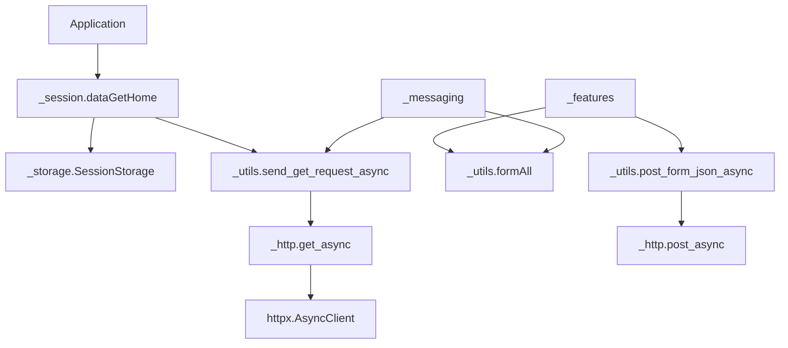

<!-- Generated by scripts/sync_canonical_package.py; do not edit directly. -->
# `_core` - Tầng nền tảng async

> Quản lý session, HTTP, lưu cookie và đăng nhập cho `fbchat-v2`.

[](README_EN.md)
[](../../DOCS.md)

## 📋 Mục lục

- [Vai trò](#vai-trò)
- [Cấu trúc thư mục](#cấu-trúc-thư-mục)
- [Public API](#public-api)
- [Hợp đồng `dataFB`](#hợp-đồng-datafb)
- [`_session.py`](#_sessionpy)
- [`_storage.py`](#_storagepy)
- [`_http.py`](#_httppy)
- [`_utils.py`](#_utilspy)
- [`_facebookLogin.py`](#_facebookloginpy)
- [Sơ đồ phụ thuộc](#sơ-đồ-phụ-thuộc)
- [Quy tắc phát triển](#quy-tắc-phát-triển)
- [Khắc phục sự cố](#khắc-phục-sự-cố)

---

## 🎯 Vai trò

`_core` cung cấp các thành phần dùng chung:

- Tạo session Facebook từ cookie.
- Chuẩn hóa HTTP request bằng `httpx`.
- Tạo form cho request GraphQL và request thông thường.
- Đọc cookie, JSON có tiền tố `for (;;);` và token trong HTML.
- Lưu cookie qua interface storage.
- Hỗ trợ đăng nhập bằng tài khoản, mật khẩu và 2FA.
- Sinh ID dùng trong request Messenger.

Các module trong `_features` và `_messaging` nên dùng lại những thành phần này, không tự tạo session hoặc transport riêng và không tắt kiểm tra TLS.

---

## 🏗️ Cấu trúc thư mục

```text
src/fbchat_v2/_core/
├── __init__.py          # Version và module exports
├── _http.py             # httpx Client/AsyncClient transport
├── _session.py          # Cookie -> dataFB
├── _storage.py          # SessionStorage implementations
├── _utils.py            # Facebook forms, parser, cookie và ID helper
├── _facebookLogin.py    # FB4A credential login và 2FA
├── _types.py            # Type dùng chung
├── README.md
└── README_EN.md
```

---

## 🌐 Public API

`src/fbchat_v2/_core/__init__.py` công bố:

```python
__all__ = ["_session", "_utils", "_facebookLogin", "__version__"]
```

Import storage và HTTP transport trực tiếp từ module tương ứng:

```python
from fbchat_v2._core._http import get_async, post_async
from fbchat_v2._core._session import dataGetHome
from fbchat_v2._core._storage import EnvSessionStorage, FileSessionStorage
```

Ứng dụng thường chỉ cần `dataGetHome`, storage và các feature công khai. Các helper cấp thấp dành cho việc viết module mới hoặc tích hợp riêng.

---

## 📝 Hợp đồng `dataFB`

`dataFB` là dict chứa session, được dùng chung ở cả ba tầng:

```python
{
    "fb_dtsg": "...",
    "fb_dtsg_ag": "...",
    "jazoest": "...",
    "hash": "...",
    "sessionID": "...",
    "FacebookID": "100012345678",
    "clientRevision": "...",
    "cookieFacebook": "c_user=...; xs=...; fr=...; datr=...;",
}
```

Các field bắt buộc được liệt kê trong `_session.REQUIRED_SESSION_FIELDS`:

- `fb_dtsg`
- `jazoest`
- `sessionID`
- `FacebookID`
- `clientRevision`

`cookieFacebook` được thêm sau bước đọc cookie. Hầu hết feature HTTP và bridge đều cần field này.

> [!WARNING]
> Toàn bộ dict chứa thông tin nhạy cảm. `fb_dtsg` và cookie có thể đủ để thực hiện thao tác trên tài khoản. Không ghi dict này vào log, gửi sang analytics hoặc đưa vào exception trả cho người dùng.

---

## 💾 `_session.py`

### `dataGetHome`

```python
async def dataGetHome(
    setCookies: str | None = None,
    storage: SessionStorage | None = None,
) -> dict[str, Any] | None:
    ...
```

Cách xử lý:

1. Dùng `setCookies` nếu có.
2. Nếu không, gọi `storage.load()`.
3. Chuyển chuỗi cookie thành cookie jar.
4. Gửi GET đến `https://www.facebook.com/` bằng transport async.
5. Gọi `raise_for_status()`.
6. Đọc các token cần thiết từ HTML.
7. Kiểm tra các field và xác nhận `FacebookID` là dạng số.
8. Trả `dataFB` hoặc `None`.

Ví dụ:

```python
import asyncio

from fbchat_v2._core._session import dataGetHome


async def main() -> None:
    data_fb = await dataGetHome("c_user=...; xs=...; fr=...; datr=...;")
    if data_fb is None:
        raise RuntimeError("Session không hợp lệ.")
    print(data_fb["FacebookID"])


asyncio.run(main())
```

Hàm trả `None` khi cookie rỗng, request hoặc HTTP status lỗi, hay thiếu token. Các lỗi session thông thường không được ném ra dưới dạng exception; bên gọi cần kiểm tra kết quả để xử lý xác thực.

---

## 📌 `_storage.py`

### `SessionStorage`

Interface trừu tượng:

```python
class SessionStorage(ABC):
    def load(self) -> str | None: ...
    def save(self, cookies: str) -> None: ...
    def clear(self) -> None: ...
```

### `FileSessionStorage`

```python
storage = FileSessionStorage("src/config.json", key="cookies")
storage.save("c_user=...; xs=...;")
cookie = storage.load()
storage.clear()
```

Đặc điểm:

- Giữ lại các key JSON khác khi cập nhật cookie.
- Trả `None` nếu file thiếu, JSON lỗi hoặc key không phải chuỗi hợp lệ.
- Báo `ValueError` nếu cookie rỗng.
- Ghi file tạm trong cùng thư mục rồi `os.replace()`.
- Đặt quyền `0600` trên hệ Unix sau khi tạo file tạm.

Ghi nguyên tử giảm nguy cơ file hỏng nhưng không mã hóa cookie. Trên máy dùng chung, vẫn cần đặt ACL phù hợp.

### `EnvSessionStorage`

```python
storage = EnvSessionStorage("FB_COOKIES")
data_fb = await dataGetHome(storage=storage)
```

`save()` chỉ thay đổi biến môi trường của process hiện tại, không lưu vào môi trường hệ thống.

---

## 🌍 `_http.py`

Transport dùng chung:

| Hàm | Loại client | Mục đích |
|---|---|---|
| `post_async` | `httpx.AsyncClient` | POST không chặn event loop |
| `get_async` | `httpx.AsyncClient` | GET không chặn event loop |
| `post_blocking` | `httpx.Client` | Dành cho code blocking tương thích cũ |
| `get_blocking` | `httpx.Client` | Dành cho code blocking tương thích cũ |

```python
request = {
    "url": "https://www.facebook.com/api/graphql/",
    "headers": {"Cookie": data_fb["cookieFacebook"]},
    "data": {"fb_dtsg": data_fb["fb_dtsg"]},
    "timeout": 30,
    "verify": True,
}

response = await post_async(request)
response.raise_for_status()
```

Transport:

- Sao chép kwargs trước khi chuẩn hóa.
- Tách `url`, `verify`, `timeout` khỏi kwargs gửi cho method HTTP.
- Loại key `proxies` kiểu cũ của `requests`.
- Tạo client tạm nếu bên gọi không truyền client.
- Không tự tắt TLS.

Nếu tự truyền client, hãy cấu hình `verify` khi tạo client đó. Giá trị `verify` trong request dict không thay đổi cấu hình của client đã có.

---

## 📌 `_utils.py`

### HTTP và JSON helper

| Hàm | Mô tả |
|---|---|
| `mainRequests(url, dataForm, setCookies)` | Tạo kwargs POST form chuẩn |
| `send_request_async(req_kwargs, client=None)` | Gửi POST và trả `httpx.Response` |
| `send_get_request_async(req_kwargs, client=None)` | Gửi GET và trả response |
| `post_form_json_async(...)` | POST form, gọi `raise_for_status`, đọc JSON |
| `parse_json_response(text, strip_for_loop_prefix=False)` | Đọc JSON, có thể bỏ tiền tố nếu được yêu cầu |

```python
from fbchat_v2._core._utils import formAll, post_form_json_async

form = formAll(
    data_fb,
    FBApiReqFriendlyName="ExampleQuery",
    docID="123456789",
)
payload = await post_form_json_async(
    "https://www.facebook.com/api/graphql/",
    form,
    data_fb["cookieFacebook"],
    strip_for_loop_prefix=True,
)
```

### Form builder

`formAll(dataFB, friendlyName, docID, requireGraphql=True)` thêm token session và metadata Facebook thường dùng. Với endpoint form không phải GraphQL, truyền `requireGraphql=False`.

Tạo dict form mới cho mỗi request; không sửa dict đang được nhiều coroutine dùng chung.

### Cookie và parser

| Hàm | Mô tả |
|---|---|
| `parse_cookie_string(cookie_str)` | Chuyển chuỗi cookie thành dict |
| `dataSplit(...)` | Đọc token từ HTML theo định dạng cũ |
| `clearHTML(text)` | Làm sạch một số HTML entity/markup |
| `formatResults(type, text)` | Kết quả success/error đơn giản |

### ID helper

| Hàm | Mục đích |
|---|---|
| `gen_threading_id()` | Offline/message threading ID |
| `generate_session_id()` | Session ID ngẫu nhiên |
| `generate_client_id()` | Client mutation/session ID |
| `str_base(number, base)` | Đổi số sang cơ số tùy chọn |
| `digitToChar(digit)` | Đổi chữ số thành ký tự trong cơ số tương ứng |

Các ID này chỉ dùng cho giao thức client, không phải token bảo mật hay khóa cơ sở dữ liệu bảo đảm duy nhất.

---

## 🔑 `_facebookLogin.py`

### API

```python
login = loginFacebook(
    username,
    password,
    AuthenticationGoogleCode=None,
    proxies=None,
)
result = await login.main()
```

`main()` chạy `main_blocking()` trên worker thread. Phần đăng nhập bên dưới vẫn dùng form FB4A cũ và `requests`.

### 2FA

`AuthenticationGoogleCode` hỗ trợ:

- OTP trực tiếp 6 đến 8 chữ số.
- TOTP secret để tính mã trên máy bằng `pyotp`.

TOTP secret không được gửi sang API bên ngoài. Module bỏ khoảng trắng khi chuẩn hóa đầu vào; nếu secret sai định dạng base32, nó trả lỗi mà không ghi secret vào log.

### Cấu hình

Module có sẵn FB4A API key và app access token mặc định. Có thể thay bằng biến môi trường:

```powershell
$env:FBCHAT_API_KEY = "<override>"
$env:FBCHAT_APP_ACCESS_TOKEN = "<override>"
```

Không ghi trực tiếp giá trị thay thế vào source. `proxies` chỉ phục vụ luồng đăng nhập cũ; các feature async dùng cấu hình proxy của `httpx.AsyncClient`, không dùng dict theo kiểu `requests` này.

### Lỗi checkpoint

Đăng nhập bằng tài khoản và mật khẩu có thể gặp:

- Yêu cầu 2FA.
- Checkpoint xác nhận thiết bị.
- Mã lỗi phụ mới.
- Response thiếu field hoặc có code `-1`.

Đọc mô tả lỗi đã loại thông tin nhạy cảm và ưu tiên session cookie khi endpoint đăng nhập không ổn định. Test giả lập không chứng minh được luồng đăng nhập với tài khoản thật.

---

## 🔗 Sơ đồ phụ thuộc



`_core` không import `_features` hoặc `_messaging`. Giữ hướng phụ thuộc này để tránh import vòng.

---

## 📏 Quy tắc phát triển

- Public API có I/O mới phải async-first.
- HTTP async phải dùng `httpx.AsyncClient`, không bọc `requests` mới bằng `to_thread` nếu không có lý do protocol cụ thể.
- Nhận `client=` khi bên gọi có thể dùng lại connection pool.
- Đặt timeout hữu hạn và gọi `raise_for_status()`.
- Tách phần tạo request, transport và parser để kiểm thử riêng.
- Không sửa dict đầu vào hoặc dùng state toàn cục để lưu dữ liệu từng request.
- Không tắt TLS verification.
- Không log cookie, password, OTP, access token hoặc toàn bộ `dataFB`.
- Helper blocking phải có hậu tố `_blocking`; không tạo alias `_sync` hoặc `_async` dư thừa.

---

## 🩺 Khắc phục sự cố

| Hiện tượng | Nguyên nhân thường gặp | Cách kiểm tra |
|---|---|---|
| `dataGetHome()` trả `None` | Cookie hết hạn hoặc token HTML đổi | Kiểm tra tên cookie và field thiếu, không log giá trị |
| HTTP 401/403 | Session hoặc token không hợp lệ | Làm mới cookie, kiểm tra checkpoint |
| HTTP timeout | Mạng, proxy hoặc endpoint chậm | Đặt timeout rõ ràng và giới hạn số lần retry ở ứng dụng |
| JSON parse lỗi | Tiền tố hoặc schema đổi | Giữ đoạn trích đã loại thông tin nhạy cảm, kiểm tra `for (;;);` |
| `coroutine was never awaited` | Gọi API async như sync | Thêm `await` hoặc `create_task` |
| Login code `-1` | Response không chuẩn hoặc transport lỗi | Đọc mô tả lỗi, kiểm tra biến môi trường thay thế, thử cookie |
| File storage trả `None` | JSON lỗi hoặc key sai | Kiểm tra file UTF-8 và key `cookies` |

Khi chẩn đoán session, chỉ ghi metadata không nhạy cảm, chẳng hạn tên field bị thiếu. Không in giá trị cookie ra terminal hoặc log.
