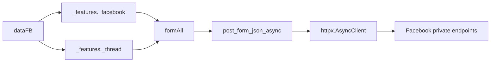

<!-- Generated by scripts/sync_canonical_package.py; do not edit directly. -->
# `_features` - Tầng nghiệp vụ Facebook async

> Các thao tác tài khoản Facebook và quản trị cuộc trò chuyện, dùng `dataFB` và transport `httpx` từ `_core`.

[](README_EN.md)
[](../../DOCS.md)

## 📋 Mục lục

- [Vai trò](#vai-trò)
- [Cấu trúc thư mục](#cấu-trúc-thư-mục)
- [Public API](#public-api)
- [Hợp đồng gọi async](#hợp-đồng-gọi-async)
- [Facebook features](#facebook-features)
- [Thread features](#thread-features)
- [Tái sử dụng HTTP client](#tái-sử-dụng-http-client)
- [Kết quả và lỗi](#kết-quả-và-lỗi)
- [Sơ đồ phụ thuộc](#sơ-đồ-phụ-thuộc)
- [Quy tắc thêm feature](#quy-tắc-thêm-feature)
- [Khắc phục sự cố](#khắc-phục-sự-cố)

---

## 🎯 Vai trò

`_features` xử lý các thao tác ngoài gửi và nhận tin nhắn:

- Thay đổi trang cá nhân và tiểu sử.
- Tạo bài viết trên dòng thời gian.
- Tìm kiếm và đọc thông tin người dùng.
- Chặn, bỏ chặn và đọc thông báo.
- Quản lý chế độ chuyên nghiệp, trang cá nhân bổ sung và Marketplace.
- Lấy metadata hộp thư và cuộc trò chuyện.
- Đổi tên, emoji, biệt danh và quản trị viên nhóm.

Tầng này nhận `dataFB` từ `fbchat_v2._core._session.dataGetHome()`. Nó không tự đọc cookie từ cấu hình hay quản lý vòng đời bot.

---

## 🏗️ Cấu trúc thư mục

```text
src/fbchat_v2/_features/
├── _facebook/
│   ├── README.md                # Tài liệu chi tiết Facebook features
│   ├── _archivePost.py          # Lưu trữ bài timeline
│   ├── _blocking.py             # Block/unblock user
│   ├── _changeBio.py            # Đổi bio
│   ├── _createPost.py           # Tạo bài timeline
│   ├── _deletePost.py           # Xóa bài timeline
│   ├── _get_user_info.py        # Profile info
│   ├── _marketplace.py          # Marketplace create/read
│   ├── _notification.py         # Notification
│   ├── _professional.py         # Professional mode
│   ├── _reactionPost.py         # Thả/gỡ cảm xúc bài viết
│   ├── _registerOnProfile.py    # Additional profile
│   ├── _search.py               # User search
│   └── _unFriend.py             # Hủy kết bạn
├── _thread/
│   ├── _addAdmin.py
│   ├── _all_thread_data.py
│   ├── _changeEmoji.py
│   ├── _changeNameThread.py
│   └── _changeNickname.py
├── README.md
└── README_EN.md
```

---

## 🌐 Public API

`_features._facebook.__all__`:

```python
[
    "_blocking",
    "_changeBio",
    "_createPost",
    "_get_user_info",
    "_marketplace",
    "_notification",
    "_professional",
    "_registerOnProfile",
    "_search",
    "_unFriend",
    "_archivePost",
    "_deletePost",
    "_reactionPost",
]
```

`_features._thread.__all__`:

```python
[
    "_changeNickname",
    "_addAdmin",
    "_changeEmoji",
    "_changeNameThread",
    "_all_thread_data",
]
```

Import module để phân biệt các hàm cùng có tên `func`:

```python
from fbchat_v2._features._facebook import _search
from fbchat_v2._features._thread import _changeEmoji

users = await _search.func(data_fb, "Minh")
changed = await _changeEmoji.func(data_fb, "thread-id", "🔥")
```

---

## 📝 Hợp đồng gọi async

Mọi feature mạng trong thư mục này là coroutine. Chữ ký thường có dạng:

```python
async def func(
    dataFB: dict[str, Any],
    feature_value: str,
    *,
    client: httpx.AsyncClient | None = None,
) -> dict[str, Any]:
    ...
```

Quy tắc:

- Luôn dùng `await`.
- Truyền `client=` bằng keyword.
- Nếu tự tạo client, bên gọi cũng chịu trách nhiệm đóng nó.
- Dữ liệu đầu vào không hợp lệ có thể gây `ValueError` hoặc `NotImplementedError` trước I/O.
- Các hàm feature thường chuyển lỗi HTTP/parser thành dict `{"error": 1, ...}`.

---

## ✨ Facebook features

Xem mô tả và ví dụ cho 13 module tại [`src/fbchat_v2/_features/_facebook/README.md`](_facebook/README.md).

### `_reactionPost.py`

```python
result = await _reactionPost.func(
    data_fb,
    postID="123456789012345",
    typeReactions="LOVE",
    client=client,
)
```

| Tham số | Kiểu | Mặc định | Mô tả |
|---|---|---|---|
| `dataFB` | `dict` | *Bắt buộc* | Dữ liệu session từ `dataGetHome()` |
| `postID` | `str` | *Bắt buộc* | ID bài viết Facebook (ID số hoặc chuỗi Base64 `feedback:...`) |
| `typeReactions` | `str` | *Bắt buộc* | Loại cảm xúc: `LIKE`, `LOVE`, `CARE`, `HAHA`, `WOW`, `SAD`, `ANGRY`, hoặc `UNDO`/`UNREACT` |
| `client` | `httpx.AsyncClient` | `None` | Client HTTP dùng chung (tùy chọn) |

- Dùng mutation `CometUFIFeedbackReactMutation` (doc_id `27646120298312844`).
- ID bài viết dạng số được mã hóa Base64 theo định dạng `feedback:<postID>`.
- Tên cảm xúc không phân biệt hoa thường và có alias (`love`, `CARE`, `support`, `sorry`, `undo`...).
- Truyền `typeReactions="UNDO"` hoặc `"UNREACT"` để gỡ cảm xúc.
- Phản hồi khi thành công:
  ```python
  {"success": 1, "messages": "Thả reaction thành công!"}
  # hoặc khi gỡ:
  {"success": 1, "messages": "Gỡ reaction thành công!"}
  ```

### `_changeBio.py`

```python
result = await _changeBio.func(
    data_fb,
    "Đang xây bot async",
    uploadPost=False,
    client=client,
)
```

| Tham số | Ý nghĩa |
|---|---|
| `newContents` | Nội dung bio mới |
| `uploadPost` | Có yêu cầu chia sẻ thay đổi hay không |

Thành công trả `{"success": 1, "messages": "..."}`. Lỗi GraphQL hoặc transport trả `{"error": 1, ...}`.

### `_createPost.py`

```python
result = await _createPost.func(
    data_fb,
    "Bài viết từ fbchat-v2",
    client=client,
)
```

Không chấp nhận nội dung rỗng. Tham số `attachmentID` vẫn có trong chữ ký nhưng chưa được hỗ trợ do schema attachment của Composer chưa ổn định. Truyền giá trị này sẽ gây `NotImplementedError`, không tự chuyển thành bài chỉ có văn bản.

Khi thành công:

```python
{
    "success": 1,
    "messages": "Tạo bài viết thành công!",
    "urlPost": "https://www.facebook.com/...",
}
```

### `_archivePost.py`

```python
result = await _archivePost.func(
    data_fb,
    "1234567890",
    typePost="my_post",
    client=client,
)
```

Dùng `useCometArchivePostMutation` để lưu trữ bài viết, với cách gọi tương tự `_deletePost`.

### `_deletePost.py`

```python
result = await _deletePost.func(
    data_fb,
    "1234567890",
    typePost="my_post",
    client=client,
)
```

Dùng `useCometTrashPostMutation` để chuyển bài viết vào thùng rác.

- `postID`: ID của bài viết cần xoá.
- `typePost`: Loại bài viết (`"my_post"` cho bài tự đăng, `"others"` cho bài chia sẻ/bài của người khác). Trả về `success` nếu thành công.

### `_professional.py`

```python
enabled = await _professional.func(data_fb, True, client=client)
disabled = await _professional.func(data_fb, "off", client=client)
```

`statusBusiness` nhận bool và các chuỗi như `on`, `off`, `bật`, `tắt`. Giá trị khác gây `ValueError`.

### `_search.py`

```python
result = await _search.func(data_fb, "m008v", client=client)
```

Khi thành công:

```python
{
    "success": 1,
    "searchResults": "Tìm kiếm Facebook: ...",
    "searchResultsDict": [
        {"name": "...", "id": "...", "url": "..."},
    ],
}
```

Parser loại trùng theo ID và lấy tối đa 5 kết quả. Từ khóa rỗng gây `ValueError`.

### `_unFriend.py`

```python
result = await _unFriend.func(
    data_fb,
    friendID="100012345678",
    client=client,
)
```

| Tham số | Kiểu | Mô tả |
|---|---|---|
| `friendID` | `str` | Facebook ID (UID) của người cần hủy kết bạn |

Dùng mutation `FriendingCometUnfriendMutation` (doc_id `8752443744796374`). ID đích được tự động mã hóa Base64 từ `restrictedUserNode{friendID}`. Khi thành công, hàm trả `{"success": 1, "messages": "Xóa bạn bè thành công!"}`.

### `_blocking.py`

```python
blocked = await _blocking.func(
    data_fb,
    "100012345678",
    "block",
    client=client,
)
unblocked = await _blocking.func(
    data_fb,
    "100012345678",
    "unblock",
    client=client,
)
```

`choiceInteract` chỉ nhận `block` hoặc `unblock`, không suy ra thao tác từ giá trị truthy/falsy.

### `_registerOnProfile.py`

```python
result = await _registerOnProfile.func(
    data_fb,
    newName="Tên profile",
    newUsername="username-mới",
    client=client,
)
```

Endpoint tạo trang cá nhân bổ sung có thể bị giới hạn theo tài khoản và đợt triển khai của Facebook. Luôn kiểm tra `result.get("error")`, kể cả khi HTTP status là 200.

### `_notification.py`

```python
result = await _notification.func(data_fb, client=client)
items = result.get("NotificationResults", [])
for item in items[:5]:
    print(item)
```

Kết quả là dict, không phải list. Lấy danh sách trong `NotificationResults` trước khi cắt; dùng trực tiếp `result[:2]` sẽ gây lỗi `slice(None, 2, None)`.

### `_get_user_info.py`

```python
profile = await _get_user_info.func(
    data_fb,
    "100012345678",
    client=client,
)
```

Kết quả có thể chứa:

```python
{
    "idUser": "...",
    "nameUser": "...",
    "firstName": "...",
    "Username": "...",
    "thumbSrc": "...",
    "urlProfile": "...",
    "genderUser": "Male (Nam)",
    "alternateName": None,
    "chatWithUSerIsNonFriend": False,
}
```

Nếu payload không chứa trang cá nhân cần tìm, module trả dict lỗi thay vì truy cập `profiles[userID]` khi chưa kiểm tra.

### `_marketplace.py`

Tạo sản phẩm:

```python
result = await _marketplace.createItem(
    data_fb,
    nameItem="Bàn phím cơ",
    brandItem="Custom",
    priceItem=1200000,
    currencyItem="VND",
    decriptionItem="Tình trạng tốt",
    hashtagList=["keyboard", "mechanical"],
    typeItem="ELECTRONICS",
    photoIDList=["photo-id"],
    locationSeller={"latitude": 10.776, "longitude": 106.700},
    client=client,
)
```

Đọc thông tin sản phẩm:

```python
details = await _marketplace.getInformationProductItemMarketPlace(
    data_fb,
    "product-id",
    client=client,
)
```

Kiểm tra trước khi gửi request:

- Tên sản phẩm không rỗng.
- Có ít nhất một ID ảnh.
- Giá chuyển được sang số và không âm.
- Vĩ độ và kinh độ nằm trong phạm vi hợp lệ.
- Danh mục/loại sản phẩm được module hỗ trợ.

---

## ✨ Thread features

### `_all_thread_data.py`

```python
threads = await _all_thread_data.func(data_fb, client=client)
```

Khi thành công:

```python
{
    "dataGet": "{...}",
    "ProcessingTime": 0.42,
    "last_seq_id": "...",
    "dataAllThread": {
        "threadIDList": ["..."],
        "threadNameList": ["..."],
        "countThread": 1,
    },
}
```

`dataGet` là chuỗi JSON của GraphQL batch đã qua parser. Kết quả là dict với các key có tên, không truy cập bằng `result[0]`.

Đọc thông tin một thread đã tải:

```python
info = await _all_thread_data.features(
    threads["dataGet"],
    "thread-id",
    "threadInfomation",
)
```

`commandUse` hỗ trợ:

| Lệnh | Kết quả |
|---|---|
| `getAdmin` | `adminThreadList` |
| `threadInfomation` | Tên, emoji, số lượng, trạng thái phê duyệt và link tham gia |
| `exportMemberListToJson` | Danh sách thành viên dạng JSON |

Tên `threadInfomation` giữ nguyên cách viết cũ để tương thích. Lệnh khác trả dict lỗi.

### `_changeNameThread.py`

```python
result = await _changeNameThread.func(
    data_fb,
    "thread-id",
    "Tên nhóm mới",
    client=client,
)
```

Tên rỗng gây `ValueError`. Module phân biệt lỗi thread không tồn tại, thiếu quyền và lỗi server.

### `_changeEmoji.py`

```python
result = await _changeEmoji.func(
    data_fb,
    "thread-id",
    "🔥",
    client=client,
)
```

Emoji rỗng bị từ chối trước khi gửi request.

### `_changeNickname.py`

```python
result = await _changeNickname.func(
    data_fb,
    "thread-id",
    "user-id",
    "Biệt danh",
    client=client,
)
```

Response phân biệt trường hợp người dùng không nằm trong thread và thread không tồn tại.

### `_addAdmin.py`

```python
added = await _addAdmin.func(
    data_fb,
    "thread-id",
    "user-id",
    statusChoice=True,
    client=client,
)
removed = await _addAdmin.func(
    data_fb,
    "thread-id",
    "user-id",
    statusChoice=False,
    client=client,
)
```

`statusChoice=False` dùng để gỡ quyền quản trị viên. Tài khoản đang đăng nhập phải có quyền quản trị và người được thay đổi quyền phải là thành viên nhóm hợp lệ.

---

## 🌍 Tái sử dụng HTTP client

Dùng chung một client khi thực hiện nhiều request:

```python
import asyncio
import httpx

from fbchat_v2._features._facebook import _notification, _search
from fbchat_v2._features._thread import _all_thread_data

async with httpx.AsyncClient(
    timeout=httpx.Timeout(30, connect=10),
) as client:
    notifications, users, threads = await asyncio.gather(
        _notification.func(data_fb, client=client),
        _search.func(data_fb, "Minh", client=client),
        _all_thread_data.func(data_fb, client=client),
    )
```

Chỉ chạy song song các thao tác độc lập. Không dùng `gather()` cho mutation phụ thuộc thứ tự, chẳng hạn xóa note rồi tạo note, hoặc thêm quản trị viên rồi đổi quyền dựa trên kết quả vừa nhận.

---

## 🩺 Kết quả và lỗi

Các module cũ chưa có định dạng kết quả thống nhất. Hai dạng thường gặp:

```python
{"success": 1, "messages": "..."}
{"error": 1, "messages": "..."}
```

Các hàm đọc dữ liệu có key riêng theo từng chức năng. Khi xử lý kết quả, nên kiểm tra kiểu và lỗi trước:

```python
result = await _search.func(data_fb, query)
if not isinstance(result, dict):
    raise TypeError("Feature không trả dict.")
if result.get("error"):
    logger.warning("Search failed: %s", result.get("messages"))
else:
    users = result.get("searchResultsDict", [])
```

HTTP 200 không đủ để xác nhận thành công. Facebook có thể đặt lỗi trong GraphQL `errors`, payload lồng nhau hoặc trả field null.

---

## 🔗 Sơ đồ phụ thuộc



`_features` phụ thuộc `_core`; `_core` không import ngược lại `_features`.

---

## 📏 Quy tắc thêm feature

1. Kiểm tra dữ liệu đầu vào trước I/O.
2. Tách `_build_request`, phần gọi transport và `_parse_response`.
3. Hàm I/O công khai dùng async và đặt tên theo quy ước module.
4. Nhận keyword-only `client: httpx.AsyncClient | None = None`.
5. Dùng helper `_core` thay vì dựng HTTP transport riêng.
6. Đặt timeout hữu hạn và giữ TLS verification.
7. Không báo thành công khi response thiếu `data` hoặc có `errors`.
8. Không âm thầm bỏ tham số chưa hỗ trợ.
9. Kiểm thử đầu vào rỗng, response thiếu field, lỗi GraphQL và trường hợp thành công.
10. Cập nhật cả README Việt, Anh và `DOCS.md`.

---

## 🩺 Khắc phục sự cố

| Hiện tượng | Nguyên nhân | Xử lý |
|---|---|---|
| `slice(None, 2, None)` ở notification | Cắt dict như list | Lấy `NotificationResults` trước |
| `All Thread Data: 0` | Truy cập response dict bằng chỉ số | Dùng `dataAllThread` hoặc `dataGet` |
| `Không tìm thấy object o0` | GraphQL batch đổi schema hoặc trả lỗi | Kiểm tra payload lỗi đã loại thông tin nhạy cảm |
| Tìm kiếm trả rỗng | Cách trả kết quả GraphQL thay đổi hoặc không có kết quả phù hợp | Kiểm tra `error`, không chỉ độ dài list |
| Đăng bài kèm attachment thất bại | Chưa hỗ trợ schema attachment của Composer | Không truyền `attachmentID`, hoặc bổ sung schema và test |
| Professional mode báo ValueError | Trạng thái đầu vào không hợp lệ | Truyền bool, `on/off` hoặc `bật/tắt` |
| Gọi HTTP nhiều lần bị chậm | Mỗi lần gọi tạo client riêng | Truyền một `httpx.AsyncClient` dùng chung |
| HTTP 200 nhưng thao tác thất bại | Lỗi nằm trong JSON | Kiểm tra `error`, `errors` và field bắt buộc |

Không dùng `except Exception: return {}` để bỏ qua lỗi parser. Hãy trả lỗi có ngữ cảnh đã loại thông tin nhạy cảm để bên gọi biết request thất bại ở đâu.
