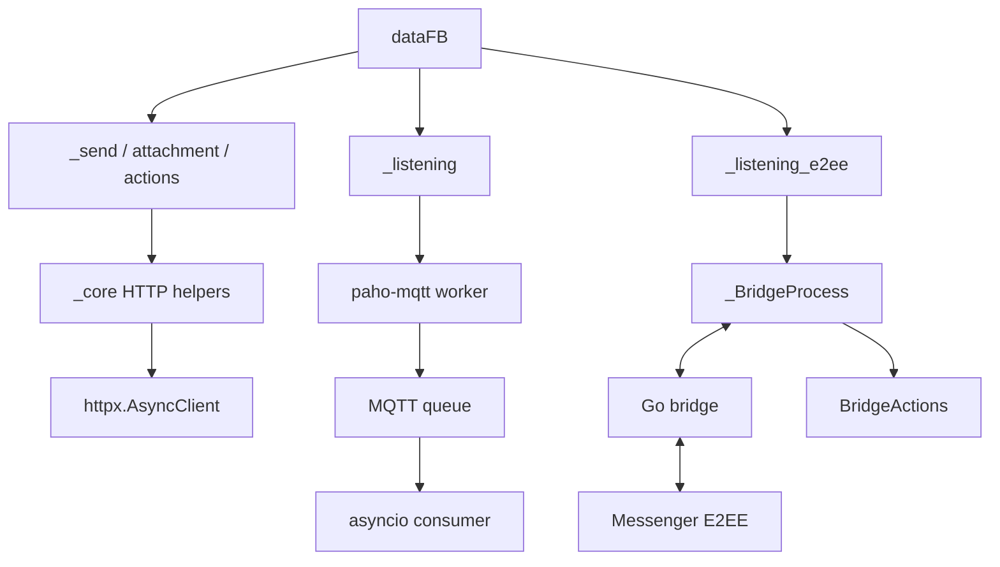

<!-- Generated by scripts/sync_canonical_package.py; do not edit directly. -->
# `_messaging` - Tầng nhắn tin async

> Gửi và nhận tin nhắn, xử lý tệp đính kèm, cảm xúc, theme, notes và E2EE trên Messenger.

[](README_EN.md)
[](../../DOCS.md)
[](../../bridge-e2ee/README.md)

## 📋 Mục lục

- [Vai trò](#vai-trò)
- [Cấu trúc thư mục](#cấu-trúc-thư-mục)
- [Cài đặt](#cài-đặt)
- [Public API](#public-api)
- [Hợp đồng `dataFB`](#hợp-đồng-datafb)
- [Gửi tin thường](#gửi-tin-thường)
- [Upload attachment](#upload-attachment)
- [Listener MQTT thường](#listener-mqtt-thường)
- [Listener E2EE](#listener-e2ee)
- [Bridge actions](#bridge-actions)
- [Standalone E2EE sender](#standalone-e2ee-sender)
- [Reaction, sửa và thu hồi](#reaction-sửa-và-thu-hồi)
- [Theme và Messenger Notes](#theme-và-messenger-notes)
- [Message requests](#message-requests)
- [Sơ đồ phụ thuộc](#sơ-đồ-phụ-thuộc)
- [Workflow hoàn chỉnh](#workflow-hoàn-chỉnh)
- [Quy tắc phát triển](#quy-tắc-phát-triển)
- [Khắc phục sự cố](#khắc-phục-sự-cố)

---

## 🎯 Vai trò

`_messaging` cung cấp các thao tác Messenger:

- Gửi văn bản và tệp đính kèm qua endpoint HTTP thường.
- Nhận event thường theo thời gian thực qua MQTT over WebSocket.
- Nhận và gửi tin nhắn cá nhân E2EE qua bridge Go.
- Sửa, thả cảm xúc, thu hồi và đánh dấu đã đọc tin nhắn; gửi trạng thái đang gõ.
- Gửi và nhận media thường hoặc E2EE.
- Đổi theme và quản lý Messenger Notes.
- Lấy danh sách tin nhắn chờ.

Module nhận `dataFB` từ `_core`, không tự lưu cookie hay quản lý thông tin đăng nhập của ứng dụng.

---

## 🏗️ Cấu trúc thư mục

```text
src/fbchat_v2/_messaging/
├── __init__.py
├── _send.py                  # Gửi text/attachment thường
├── _attachments.py           # Upload file -> attachment ID
├── _listening.py             # MQTT listener thường
├── _listening_e2ee.py        # Bridge process và listener E2EE
├── _bridge_actions.py        # Action async qua JSON-RPC
├── _send_e2ee.py             # Standalone compatibility sender
├── _editMessage.py           # Sửa tin qua LS task
├── _reactions.py             # Add/remove reaction
├── _unsend.py                # Thu hồi tin thường qua HTTP
├── _changeTheme.py           # Theme query và LS task
├── _createNotes.py           # Messenger Notes 24 giờ
├── _message_requests.py      # Pending inbox
├── README.md
└── README_EN.md
```

---

## ⚙️ Cài đặt

Cài package Python:

```bash
python -m pip install -e .
```

Các dependency chính:

| Package | Dùng cho |
|---|---|
| `httpx` | Gửi tin, upload khi truyền client, cảm xúc, thu hồi và tin nhắn chờ |
| `paho-mqtt` | Listener thường và LS task |
| `requests` | Upload tương thích cũ khi không truyền async client |

### Bridge E2EE

`bridge-e2ee/go.mod` yêu cầu Go 1.26.9.

```bash
git submodule update --init --recursive bridge-e2ee/meta
cd bridge-e2ee
go mod download
mkdir -p ../build
go build -ldflags="-s -w" -o ../build/fbchat-bridge-e2ee .
```

Trên Windows, đặt tên file đầu ra là `..\build\fbchat-bridge-e2ee.exe`.

Python tìm binary theo thứ tự `binary_path=`, `FBCHAT_E2EE_BIN`, rồi đường dẫn mặc định trong `build/`. Chỉ khi thiếu file ở đường dẫn mặc định, thư viện mới tự tải asset từ release.

---

## 🌐 Public API

`src/fbchat_v2/_messaging/__init__.py`:

```python
__all__ = [
    "_attachments",
    "_changeTheme",
    "_createNotes",
    "_editMessage",
    "_listening",
    "_listening_e2ee",
    "_reactions",
    "_send",
    "_send_e2ee",
    "_unsend",
    "_message_requests",
]
```

`_bridge_actions` có thể import trực tiếp:

```python
from fbchat_v2._messaging._bridge_actions import BridgeActions
```

Các API async chính:

| Module | API chính |
|---|---|
| `_send.py` | `await api().send(...)` |
| `_attachments.py` | `await func(...)` |
| `_listening.py` | `await connect_mqtt()`, `get_message()`, `disconnect()` |
| `_listening_e2ee.py` | `await connect_mqtt()`, `send_message()`, `send_e2ee_message()` |
| `_bridge_actions.py` | Các method async không có hậu tố |
| `_editMessage.py` | `await editMessage(...)` hoặc `func(...)` |
| `_reactions.py` | `await func(...)` |
| `_unsend.py` | `await func(...)` |
| `_changeTheme.py` | `await listThemes/findTheme/changeTheme/func` |
| `_createNotes.py` | `await checkNote/createNote/deleteNote/recreateNote/func` |
| `_message_requests.py` | `await func(...)` |

Các helper blocking có hậu tố `_blocking`. Không có alias `func_async` hoặc `func_sync`.

---

## 📝 Hợp đồng `dataFB`

Field thường dùng:

```python
{
    "fb_dtsg": "...",
    "jazoest": "...",
    "sessionID": "...",
    "FacebookID": "1000...",
    "clientRevision": "...",
    "cookieFacebook": "c_user=...; xs=...; fr=...; datr=...;",
}
```

Tạo bằng:

```python
from fbchat_v2._core._session import dataGetHome

data_fb = await dataGetHome(cookie)
if data_fb is None:
    raise RuntimeError("Session không hợp lệ.")
```

Bridge E2EE cần các cookie `c_user`, `xs`, `datr`, `fr`. Khi chẩn đoán cookie bị thiếu, chỉ ghi tên field vào log, không ghi giá trị.

---

## 💬 Gửi tin thường

### Chữ ký

```python
await api().send(
    dataFB,
    contentSend,
    threadID,
    typeAttachment=None,
    attachmentID=None,
    typeChat=None,
    replyMessage=None,
    messageID=None,
    client=None,
)
```

### Tham số

| Tham số | Mô tả |
|---|---|
| `contentSend` | Văn bản; có thể rỗng nếu có tệp đính kèm |
| `threadID` | ID người dùng, ID cuộc trò chuyện nhóm hoặc list ID người dùng |
| `typeChat` | `"user"` cho người nhận trực tiếp, `None` cho cuộc trò chuyện nhóm |
| `typeAttachment` | `gif`, `image`, `video`, `file`, `audio` |
| `attachmentID` | Một ID hoặc list ID nhận được sau upload |
| `replyMessage` | Thêm metadata trả lời tin nhắn |
| `messageID` | ID tin nhắn gốc, bắt buộc khi trả lời |
| `client` | `httpx.AsyncClient` dùng chung, không bắt buộc |

### Gửi text

```python
from fbchat_v2._messaging._send import api as SendAPI

sender = SendAPI()
result = await sender.send(
    data_fb,
    "Xin chào",
    threadID="100012345678",
    typeChat="user",
)
```

### Gửi group

```python
result = await sender.send(
    data_fb,
    "Thông báo nhóm",
    threadID="group-thread-id",
    typeChat=None,
)
```

### Gửi nhiều user

```python
result = await sender.send(
    data_fb,
    "Thông báo riêng",
    threadID=["10001", "10002"],
    typeChat="user",
)
```

### Reply

```python
result = await sender.send(
    data_fb,
    "Nội dung trả lời",
    threadID="100012345678",
    typeChat="user",
    replyMessage=True,
    messageID="mid.$original",
)
```

### Kết quả

Khi thành công:

```python
{
    "success": 1,
    "payload": {
        "messageID": "mid.$...",
        "timestamp": 1710000000000,
    },
}
```

Khi parser hoặc server trả lỗi:

```python
{
    "error": 1,
    "payload": {
        "error-description": "...",
        "error-code": 123,
    },
}
```

Đầu vào không hợp lệ gây `ValueError` trước khi gửi request. Mỗi lần gọi tạo form riêng nên nhiều coroutine có thể dùng chung một `SendAPI`. `sender.results` chỉ giữ kết quả của lần gọi hoàn tất gần nhất; hãy dùng dict được trả về để xử lý từng request.

---

## 📎 Upload attachment

### Chữ ký

```python
await _attachments.func(
    filenames,
    dataFB,
    client=None,
    include_error=False,
)
```

`filenames` nhận `str` hoặc `list[str]`. List rỗng gây `ValueError`; đường dẫn không tồn tại gây `FileNotFoundError`.

Parser hiện chỉ trả metadata của file đầu tiên. Để gửi nhiều file, hãy upload từng file, kiểm tra từng `attachmentID`, rồi truyền list ID vào sender. Truyền list đường dẫn vào hàm upload không có nghĩa kết quả sẽ là list.

```python
from fbchat_v2._messaging import _attachments

uploaded = await _attachments.func(
    "photo.jpg",
    data_fb,
    include_error=True,
)
```

Khi thành công:

```python
{
    "attachmentID": "123...",
    "attachmentUrl": "https://...",
    "videoDuration": None,
    "attachmentType": "image/jpeg",
    "typeAttachment": "image",
}
```

Khi gửi, dùng `typeAttachment`, không dùng MIME trong `attachmentType`:

```python
if not uploaded or not uploaded.get("attachmentID"):
    raise RuntimeError(f"Upload thất bại: {uploaded}")

result = await sender.send(
    data_fb,
    "Ảnh đính kèm",
    threadID="100012345678",
    typeChat="user",
    typeAttachment=uploaded["typeAttachment"],
    attachmentID=uploaded["attachmentID"],
)
```

### Error diagnostics

`include_error=True` trả payload có giới hạn:

```python
{
    "error": 1,
    "payload": {
        "error-code": 1357054,
        "error-summary": "...",
        "error-description": "...",
        "upload-id": None,
        "metadata": None,
        "file-rejected": False,
        "raw-excerpt": "...",
    },
}
```

`uploadID` không phải `attachmentID`. Nếu `metadata["0"] is None`, chưa thể coi upload thành công. File handle luôn được đóng trong `finally`, kể cả khi request hoặc parser lỗi.

Nếu không truyền async client, wrapper chạy phần upload tương thích cũ trên worker thread. Khi có `httpx.AsyncClient`, request multipart chạy trực tiếp theo async.

---

## 📡 Listener MQTT thường

### Khởi tạo

```python
from fbchat_v2._messaging._listening import listeningEvent

listener = listeningEvent(
    data_fb,
    message_queue_maxsize=1000,
)
```

### Lifecycle

```python
import asyncio

task = asyncio.create_task(listener.connect_mqtt())
try:
    while True:
        if task.done():
            task.result()
        event = await listener.get_message(timeout=30)
        if event is not None:
            print(event)
finally:
    await listener.disconnect()
    await task
```

| Method | Mô tả |
|---|---|
| `get_last_seq_id()` | Lấy sequence ID ban đầu theo async |
| `connect_mqtt()` | Đưa vòng lặp `paho-mqtt` blocking sang worker thread |
| `get_message(timeout=None)` | Lấy event từ queue hoặc trả `None` khi timeout |
| `disconnect()` | Dừng client và reconnect loop |

Event sau khi chuẩn hóa:

```python
{
    "body": "ping",
    "timestamp": 1710000000000,
    "userID": "1000...",
    "messageID": "mid.$...",
    "replyToID": "thread-id",
    "type": "thread",
    "attachments": {"id": 0, "url": None},
    "mentions": [],
}
```

Listener đọc toàn bộ delta, kiểm tra TLS và dùng queue có giới hạn. Khi queue đầy, nó bỏ event cũ nhất và tăng `droppedMessages` để tránh tích dữ liệu không giới hạn trong RAM.

`bodyResults` chỉ giữ snapshot để tương thích code cũ. Bot mới cần đọc queue qua `get_message()` để không bỏ lỡ các event đến liên tiếp.

Vòng lặp bên ngoài quản lý reconnect. Không gọi đệ quy `connect_mqtt()` trong callback vì có thể tạo thêm client và làm stack tăng sau mỗi lần mất kết nối.

---

## 🔐 Listener E2EE

### Khởi tạo

```python
from fbchat_v2._messaging._listening_e2ee import listeningE2EEEvent

listener = listeningE2EEEvent(
    data_fb,
    log_level="none",
    device_path=None,
    e2ee_memory_only=True,
    enable_e2ee=True,
    binary_path=None,
)
```

### Public API

| Method | Loại | Mô tả |
|---|---|---|
| `on_message(fn)` | đăng ký đồng bộ | Đăng ký callback nhận event thô |
| `wait_until_connected(timeout, require_e2ee=False)` | chờ blocking | Chờ handshake, gọi qua `to_thread` |
| `connect_mqtt()` | async | Khởi chạy bridge, kết nối và đọc event |
| `send_message(...)` | async | Gửi tin thường qua bridge |
| `send_e2ee_message(...)` | async | Gửi văn bản E2EE |
| `stop()` | tín hiệu đồng bộ | Dừng listener và bridge |

### Callback thread-safe

Callback của bridge không chạy trên asyncio event loop. Chuyển event sang queue trong loop như sau:

```python
import asyncio

loop = asyncio.get_running_loop()
events: asyncio.Queue[dict] = asyncio.Queue(maxsize=1000)


def enqueue(event: dict) -> None:
    if events.full():
        events.get_nowait()
    events.put_nowait(event)


listener.on_message(
    lambda event: loop.call_soon_threadsafe(enqueue, event)
)
task = asyncio.create_task(listener.connect_mqtt())
```

Không viết:

```python
threading.Thread(target=listener.connect_mqtt).start()
```

`connect_mqtt` là coroutine. Nếu truyền trực tiếp làm thread target, coroutine sẽ được tạo nhưng không được `await`, dẫn đến `RuntimeWarning` và listener không chạy.

### Đợi ready

```python
ready = await asyncio.to_thread(
    listener.wait_until_connected,
    listener.startup_timeout,
    require_e2ee=True,
)
if not ready:
    raise TimeoutError("E2EE listener chưa sẵn sàng.")
```

`startup_timeout` là giới hạn tổng, lớn hơn tổng timeout của từng bước khởi động.
Khi lỗi xảy ra, wrapper giữ chuỗi exception gốc và cho biết bước thất bại,
không để timeout bên ngoài che mất lỗi `contract`, `regular ready` hoặc `E2EE ready`.

### Event raw

```python
{
    "type": "e2eeMessage",
    "data": {
        "id": "...",
        "text": "ping",
        "timestampMs": 1710000000000,
        "senderId": "1000...",
        "threadId": "...",
        "chatJid": "1000...@msgr",
        "senderJid": "1000...@msgr",
        "attachments": [],
        "mentions": [],
    },
}
```

Các loại event thường gặp:

| Type | Ý nghĩa |
|---|---|
| `ready` | Client bridge sẵn sàng |
| `e2eeConnected` | E2EE handshake xong |
| `message` | Tin thường |
| `e2eeMessage` | Tin nhắn trực tiếp đã giải mã |
| `reconnected` | Transport nối lại |
| `disconnected` | Mất kết nối |
| `error` | Lỗi bridge hoặc transport |
| `bridge_fatal` | Watchdog vượt giới hạn retry |

### Send text và reply

```python
result = await listener.send_e2ee_message(
    "100012345678@msgr",
    "Xin chào E2EE",
)
```

Trả lời dựa trên event thô:

```python
data = event["data"]
result = await listener.send_e2ee_message(
    data["chatJid"],
    "pong",
    reply_to_id=data["id"],
    reply_to_sender_jid=data["senderJid"],
)
```

### Shutdown

```python
try:
    ...
finally:
    listener.stop()
    await task
```

Watchdog tự khởi chạy lại bridge tối đa 5 lần, có backoff. Ứng dụng vẫn cần theo dõi listener task và event `bridge_fatal`.

---

## 🌉 Bridge actions

```python
from fbchat_v2._messaging._bridge_actions import BridgeActions

if listener._bridge is None:
    raise RuntimeError("Bridge chưa sẵn sàng.")
actions = BridgeActions(listener._bridge)
```

### Message actions

```python
await actions.edit_message("mid.$...", "Text mới")
await actions.unsend_message("mid.$...")

await actions.edit_e2ee_message(
    "100012345678@msgr",
    "message-id",
    "Text E2EE mới",
)
await actions.unsend_e2ee_message(
    "100012345678@msgr",
    "message-id",
)
```

### Presence actions

```python
await actions.send_typing_indicator(
    thread_id=123456789,
    is_typing=True,
    is_group=False,
)
await actions.mark_read(
    thread_id=123456789,
    watermark_ts=1710000000000,
)
await actions.send_e2ee_typing(
    "100012345678@msgr",
    True,
)
```

### E2EE image và audio

```python
from pathlib import Path
import asyncio

image = await asyncio.to_thread(Path("photo.jpg").read_bytes)
await actions.send_e2ee_image(
    "100012345678@msgr",
    image,
    mime_type="image/jpeg",
    caption="Ảnh test",
    width=0,
    height=0,
)

audio = await asyncio.to_thread(Path("voice.ogg").read_bytes)
await actions.send_e2ee_audio(
    "100012345678@msgr",
    audio,
    mime_type="audio/ogg; codecs=opus",
    duration=3200,
    ptt=True,
)
```

Dữ liệu nhị phân được mã hóa base64 khi đi qua JSON-RPC. `_BridgeProcess` giới hạn request JSON-RPC ở 150 MiB; base64 làm payload tăng khoảng một phần ba, nên file nguồn phải nhỏ hơn đáng kể.

### Download media

```python
content: bytes = await actions.download_media(url)
```

Media E2EE cần đầy đủ metadata từ event đính kèm:

```python
result = await actions.download_e2ee_media(
    direct_path=attachment["directPath"],
    media_key=attachment["mediaKey"],
    media_sha256=attachment["mediaSha256"],
    media_enc_sha256=attachment["mediaEncSha256"],
    media_type=attachment["mediaType"],
    mime_type=attachment["mimeType"],
    file_size=int(attachment["fileSize"]),
)
content = result["data"]
```

Wrapper giải mã base64 thành bytes và giữ các metadata còn lại trong dict.

---

## 🔐 Standalone E2EE sender

`_send_e2ee.api` là sender blocking dành cho code tương thích cũ. Nó có hai cách dùng:

1. Dùng lại bridge của listener.
2. Khởi chạy bridge riêng và tự kết nối.

```python
from fbchat_v2._messaging._send_e2ee import api as E2EESender

sender = E2EESender(listener=listener)
result = await asyncio.to_thread(
    sender.send,
    "100012345678",
    "Hello",
)
```

Standalone:

```python
sender = E2EESender(dataFB=data_fb)
try:
    await asyncio.to_thread(sender.connect)
    result = await asyncio.to_thread(
        sender.send_to_user,
        "100012345678",
        "Hello",
    )
finally:
    await asyncio.to_thread(sender.close)
```

Ứng dụng async mới nên gọi trực tiếp `listener.send_e2ee_message()`. Sender độc lập có pairing và vòng đời riêng, nên hãy kiểm soát việc tạo thêm bridge process.

`normalize_chat_jid()` chuyển Facebook ID dạng số thành `<id>@msgr`, giữ nguyên JID đầy đủ và từ chối chuỗi không phải ID/JID.

---

## 🔄 Reaction, sửa và thu hồi

### Reaction

```python
from fbchat_v2._messaging import _reactions

response = await _reactions.func(
    data_fb,
    "add",
    "mid.$message",
    "🔥",
    client=client,
)
payload = response.json()
```

`typeAdded` nhận `add`, `ADD_REACTION`, `remove`, `REMOVE_REACTION` không phân biệt hoa thường. Hàm trả `httpx.Response` thô sau khi gọi `raise_for_status()`; bên gọi vẫn phải kiểm tra lỗi GraphQL trong JSON.

### Sửa tin thường bằng LS task

```python
from fbchat_v2._messaging import _editMessage

result = await _editMessage.func(
    data_fb,
    "mid.$message",
    "Nội dung mới",
    timeout=20,
)
```

`editMessage()` và `func()` đều là API async. Kết quả thành công chỉ xác nhận task đã được publish; server vẫn có thể từ chối tin nhắn cũ hoặc không thuộc tài khoản.

### Thu hồi qua HTTP

```python
from fbchat_v2._messaging import _unsend

result = await _unsend.func(
    "mid.$message",
    data_fb,
    client=client,
)
```

ID tin nhắn rỗng gây `ValueError`. Nếu response không phải JSON hợp lệ hoặc chứa lỗi, hàm trả dict lỗi.

---

## 🎨 Theme và Messenger Notes

### Theme

```python
from fbchat_v2._messaging import _changeTheme

themes = await _changeTheme.listThemes(data_fb)
match = await _changeTheme.findTheme(data_fb, "love")
changed = await _changeTheme.changeTheme(
    data_fb,
    "thread-id",
    "love",
)
```

Entry point:

```python
await _changeTheme.func(data_fb, action="list")
await _changeTheme.func(data_fb, themeName="love", action="find")
await _changeTheme.func(
    data_fb,
    threadID="thread-id",
    themeName="love",
    action="set",
)
```

`findTheme` tìm theo ID, tên chính xác, rồi từ khóa. `changeTheme` publish các LS task cần thiết để đổi theme. Publish thành công không bảo đảm server đã áp dụng thay đổi.

### Notes

```python
from fbchat_v2._messaging import _createNotes

current = await _createNotes.checkNote(data_fb)
created = await _createNotes.createNote(
    data_fb,
    "Đang code fbchat-v2",
    privacy="FRIENDS",
)
deleted = await _createNotes.deleteNote(data_fb, "note-id")
replaced = await _createNotes.recreateNote(
    data_fb,
    "old-note-id",
    "Note mới",
)
```

Hàm `func` hỗ trợ `check`, `create`, `delete`, `recreate`. Văn bản hoặc ID note rỗng trả lỗi. Module đặt thời hạn mặc định cho note là 24 giờ.

`recreateNote` xóa note cũ rồi tạo note mới. Nếu bước tạo thất bại, không có rollback phía server để khôi phục note cũ.

---

## 📬 Message requests

```python
from fbchat_v2._messaging import _message_requests

result = await _message_requests.func(data_fb, client=client)
if result.get("success"):
    pending = result["data"]
    print(pending["total_count"])
```

Khi thành công:

```python
{
    "success": 1,
    "messages": "Lấy danh sách message requests thành công.",
    "data": {
        0: {
            "senderID": "...",
            "snippet": "...",
            "timestamp_precise": "...",
        },
        "total_count": 1,
    },
}
```

Parser đọc GraphQL batch gồm các JSON object liên tiếp để tìm object `o0`. Nếu response chứa lỗi hoặc không đọc được, hàm trả dict lỗi.

---

## 🔗 Sơ đồ phụ thuộc



---

## 🛤️ Workflow hoàn chỉnh

### Bot nhận và reply E2EE

```python
import asyncio

from fbchat_v2._messaging._listening_e2ee import listeningE2EEEvent


async def run(data_fb: dict) -> None:
    listener = listeningE2EEEvent(data_fb)
    loop = asyncio.get_running_loop()
    queue: asyncio.Queue[dict] = asyncio.Queue(maxsize=1000)

    def enqueue(event: dict) -> None:
        if queue.full():
            queue.get_nowait()
        queue.put_nowait(event)

    listener.on_message(
        lambda event: loop.call_soon_threadsafe(enqueue, event)
    )
    listener_task = asyncio.create_task(listener.connect_mqtt())

    try:
        ready = await asyncio.to_thread(
            listener.wait_until_connected,
            listener.startup_timeout,
            require_e2ee=True,
        )
        if not ready:
            raise TimeoutError("Bridge chưa sẵn sàng.")

        while True:
            if listener_task.done():
                listener_task.result()
            event = await queue.get()
            if event.get("type") != "e2eeMessage":
                continue
            data = event.get("data") or {}
            if data.get("text") != "/ping":
                continue
            await listener.send_e2ee_message(
                data["chatJid"],
                "pong",
                reply_to_id=data["id"],
                reply_to_sender_jid=data["senderJid"],
            )
    finally:
        listener.stop()
        await listener_task
```

Khi dùng trong ứng dụng thật, cần thêm chống trùng theo ID tin nhắn, bỏ qua tin do bot gửi, log có cấu trúc, cách xử lý quá tải queue, cancellation và metric cho listener task.

---

## 📏 Quy tắc phát triển

- Public I/O API mới dùng async và tên không có hậu tố `_async`.
- Helper blocking phải có `_blocking` và chỉ được gọi ở nơi đã xử lý việc chặn event loop.
- HTTP async dùng `httpx.AsyncClient` và nhận `client=` tùy chọn.
- Không sửa form dùng chung giữa nhiều coroutine.
- Callback listener không chạy coroutine trực tiếp; chuyển event vào loop bằng queue và cơ chế thread-safe.
- Queue phải có giới hạn và quy định rõ cách xử lý khi đầy.
- Khi shutdown, luôn gọi stop/disconnect rồi `await` listener task.
- Kiểm tra ID, enum, file và metadata đính kèm trước request tiếp theo.
- Không coi việc publish LS task là xác nhận server đã áp dụng mutation.
- Không log cookie, `dataFB`, device state hoặc media key E2EE.
- Khi thêm bridge RPC, cập nhật Go dispatcher, Python wrapper, test và README cùng lúc.

---

## 🩺 Khắc phục sự cố

| Hiện tượng | Nguyên nhân thường gặp | Cách xử lý |
|---|---|---|
| `coroutine connect_mqtt was never awaited` | Đưa coroutine vào `threading.Thread` | Dùng `create_task` và `await` |
| `'coroutine' object has no attribute 'get'` | Gọi method bridge async như hàm đồng bộ | `await call()` hoặc nội bộ dùng `call_blocking()` |
| Listener không nhận tin | Callback đăng ký muộn, handshake chưa xong hoặc task đã dừng | Đăng ký callback trước khi chạy, chờ ready và theo dõi task |
| Mất event khi nhiều tin đến liên tiếp | Chỉ đọc snapshot `bodyResults` | Đọc queue bằng `get_message()` hoặc queue của ứng dụng |
| Queue bỏ event | Consumer chậm | Tối ưu handler, tăng giới hạn có kiểm soát, theo dõi metric |
| Upload trả `None` | Response không có metadata hợp lệ | Bật `include_error=True`, kiểm tra session/file/endpoint |
| Upload có `uploadID` nhưng thiếu attachment ID | Server không chấp nhận file | Không dùng `uploadID` để gửi tin |
| Gửi tin báo invalid attachment type | Truyền MIME thay vì loại đã chuẩn hóa | Dùng `uploaded["typeAttachment"]` |
| Gửi E2EE trước khi kết nối | Chưa hoàn tất handshake | Chờ `wait_until_connected(..., require_e2ee=True)` |
| Thiếu binary bridge | Chưa build/submodule hoặc đường dẫn thay thế sai | Build đúng phiên bản Go, kiểm tra `FBCHAT_E2EE_BIN` |
| Bridge khởi chạy lại liên tục | Cookie lỗi, binary crash hoặc lệch version | Đọc stderr, kiểm tra build và event `bridge_fatal` |
| Sửa tin/theme báo thành công nhưng UI không đổi | Chỉ mới publish LS task | Server có thể từ chối; kiểm tra event hoặc UI sau đó |
| Reaction trả HTTP 200 nhưng không đổi | GraphQL body chứa lỗi | Đọc `response.json()` và kiểm tra `errors` |

Nếu listener không chạy, kiểm tra task, handshake và callback trước khi tạo thêm instance. Chạy thêm thread có thể tạo bridge process và pairing state trùng, không giải quyết được lỗi gốc.
